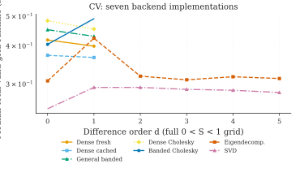
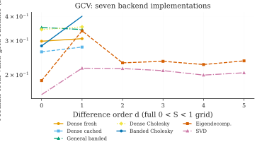
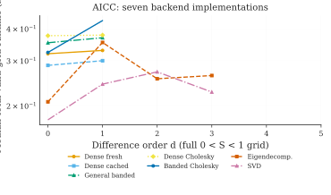
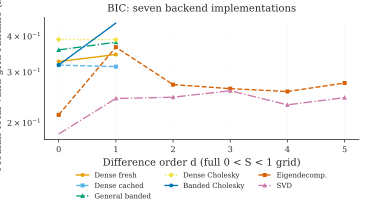
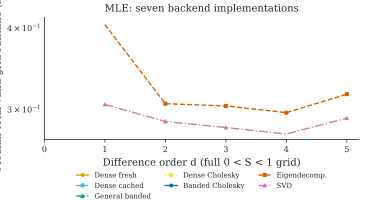
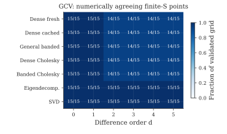
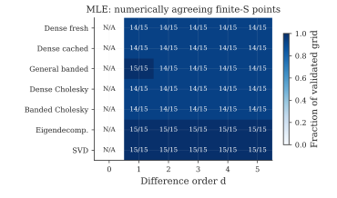
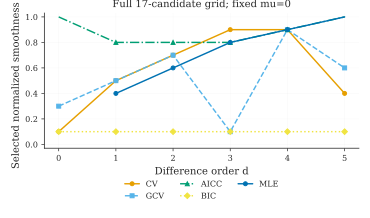
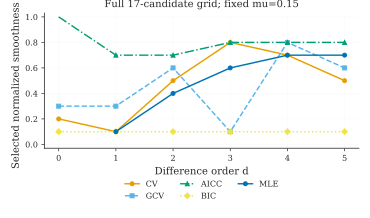
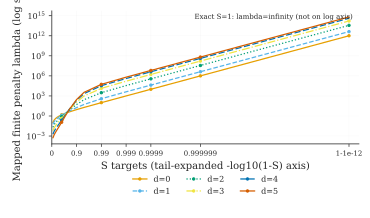

Complete smoothness domain: all solvers and criteria
=====================================================

This experiment searches the **entire normalized smoothness domain**,
including both exact limits and the finite values closest to one.
The preceding finite grid experiments deliberately omitted extreme
conditioning. Here that conditioning is itself part of the study.

The common 17-point grid
------------------------

.. math::

   S \in \{0,0.1,0.2,\ldots,0.9,1\}
   \cup\{0.95,0.99,0.999,0.9999,0.999999,0.999999999999\}.

Each interior smoothness target is inverted **once** to obtain the
same penalty for every backend. The exact limits are not approximated
by a huge/small float.

- **S=0, lambda=0:** trend equals observations; conventional
  interpolation-only CV and GCV scores are undefined.
- **S=1, lambda=infinity:** for d>=1 the limiting trend is a
  polynomial of degree d-1 after applying the fixed difference-mean
  adjustment. For d=0 it is the constant vector mu.
  Exact endpoint scores come from analytical limits, not an
  infinite Cholesky factorization.
- **Gaussian MLE at d=0:** not implemented for this stochastic model;
  recorded as *not applicable*. Other four criteria are tested for d=0.

Seven numerical solvers, five statistical criteria
--------------------------------------------------

The seven backends are dense fresh, dense cached, general banded,
dense Cholesky, banded Cholesky, symmetric eigendecomposition (eigh),
and SVD.

The five statistical selection rules are CV, GCV, AICc, BIC and
conditional Gaussian profiled marginal MLE.

All valid combinations test both fixed mu=0 and mu=0.15, and
all difference orders **d=0,1,2,3,4,5**. Each backend scores the
same observations and identical candidate penalties. The separate
coordinate-timing experiment tests repeated S inversion versus
reusing an already mapped lambda grid; these are distinct questions.

A numerical instability or factorization failure at the largest
finite lambda is **not** evidence of a smaller statistical optimum.
Only methods whose entire finite interior grid agrees numerically
can be ranked as valid whole-grid timing winners. Mathematically
undefined criterion values are recorded separately.

Full-grid computation time
--------------------------

For each criterion the following charts show total time, including
backend preparation and finite interior scoring. An absent solver
point means it did **not** complete the entire grid accurately.

Stability across the near-one tail
----------------------------------

Each cell counts verified finite interior candidates, out of fifteen.
An unstable score may be due to an ill-conditioned finite penalty
matrix, cancellation or the particular criterion's singularity.

Selection results for both reference means
------------------------------------------

These are the criterion-optimal candidate smoothness levels on the
common grid, computed through the validated SVD implementation.
**Criterion scores should not be compared across criterion types.**

The high-smoothness penalty tail
--------------------------------

The chart excludes lambda=0 and lambda=infinity only because neither
can be represented on a finite logarithmic axis. **Both were scored.**

Experiment provenance and reproduction
--------------------------------------

The full measurement matrix and original failure states are archived:

- ``paper/benchmarks/full_s_reference/candidate_scores_and_times.csv``
- ``paper/benchmarks/full_s_reference/full_grid_summary.csv``
- ``paper/benchmarks/full_s_reference/s_lambda_grid.csv``
- ``paper/benchmarks/full_s_reference/environment.json``

A reference run uses n=24, one independent seeded synthetic series
and two timing repetitions on a GitHub-hosted Linux machine.
These measurements do **not** use the author's Windows full experiment
or establish a universally fastest implementation.

Repeat on Windows PowerShell (new output directory):

.. code-block:: powershell

   conda activate trendestimation
   python paper/benchmarks/full_s_backend_criteria.py --preset full --repeats 5
   python paper/figures/render_full_s_factorial.py

The full preset additionally studies n=48 and a second seed.
The experiment is classical **in-sample** selection, not forecast
cross-validation or out-of-sample prediction.

See :doc:`mle_coordinate_figures` for public-selection
search-space timing with native S versus reusable lambda, and
:doc:`grid_reuse_selection` for the separate GCV repeated-series study.
