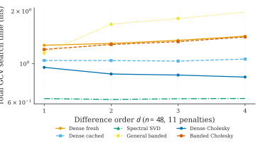
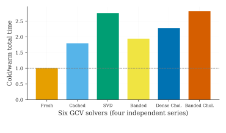
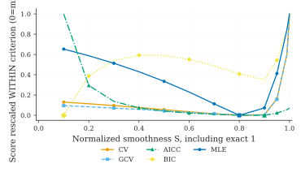
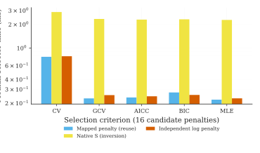

Measured solver and MLE selection figures
=========================================

These figures are rendered with the pinned
`awesomefigures` library and the Springer Nature
publication-style pipeline. The paper uses PDF vectors and the
website uses corresponding browser SVGs. Each figure reads
archived, genuinely measured CSV files, not invented runtimes.

Six-backend GCV selection across difference orders
---------------------------------------------------

For the recorded GitHub Linux run, `n=48`,
11 finite log-penalty candidates, fixed `mu=0` and one
independent series, spectral SVD was fastest in the
sampled difference orders 1 to 4. The benchmark times
**actual GCV** (including the trace/EDF required to score),
not only full trend reconstruction.

Reusing preprocessing across independent series
------------------------------------------------

For the same penalty candidates reused across four
independent series, caching spectral data or fixed-penalty
Cholesky factors reduces repeated work. A Cholesky factor
**cannot** be reused when the penalty itself changes.

Criterion profiles, now including Gaussian marginal MLE
-------------------------------------------------------

These five *selection criteria* measure different statistical
objectives, not five equivalent linear algebra decompositions.
The conditional Gaussian marginal MLE profiles observation
variance after removing unpenalized polynomial coordinates.
It uses a fixed numeric difference-reference mean.
The empirical plug-in `mu="data"` and joint
estimation of mu with lambda are separate questions.

**Important:** each score is rescaled only *within itself*
to display curvature and optimal S. The heights of MLE,
AICc, BIC and squared-error criteria cannot be compared
across methods as if they had identical units.
The exact S=1 limit is included; MLE is undefined at
S=0 (lambda=0) under its improper variance prior.

Timing the S-versus-lambda search
---------------------------------

Three candidate policies are compared. `matched_lambda`
maps the same sixteen S targets *once* into a reusable
penalty grid, then scores all criteria; `native_s`
recomputes the inverse for each criterion; an independent
log-penalty grid uses the same number of candidates
but not the same interior penalties.
The first two produce matching scores and identical
selected penalties to numerical tolerance.

All timings in this figure exclude common one-time SVD
construction. The precomputed mapped-grid inversion cost
is measured separately in the raw result files. Consequently
the figure is **not** an assertion about arbitrary complete
end-to-end workflows.

Data, replication and limitations
---------------------------------

The benchmark sources and CSV files are:

- `paper/benchmarks/grid_reuse_reference/gcv_grid_timings.csv`
- `paper/benchmarks/selection_coordinate_reference/selector_timings.csv`
- `paper/benchmarks/selection_coordinate_reference/criterion_score_paths.csv`
- `paper/benchmarks/selection_coordinate_reference/coordinate_grids.csv`
- The accompanying `environment.json` files record
  machine, software, BLAS and sample provenance.

Run `python paper/benchmarks/selection_coordinate_mle.py`
to regenerate the public-API five-criterion comparison and
`python paper/figures/render_awesomefigures.py --benchmarks-only`
to render vectors from recorded results. The second command
requires the pinned AwesomeFigures library and a TeX installation.

See :doc:`grid_reuse_selection` and
:doc:`notebooks/13-grid-search-repeated-solvers-orders`
for the independent six-backend GCV study, and
:doc:`notebooks/09-gaussian-mle-and-guerrero-smoothness`
for the mathematical Gaussian MLE derivation.

The recorded timings are host-specific; they do not establish
statistical dominance across machines, superior forecasting
accuracy, or joint inference over mu and lambda.
