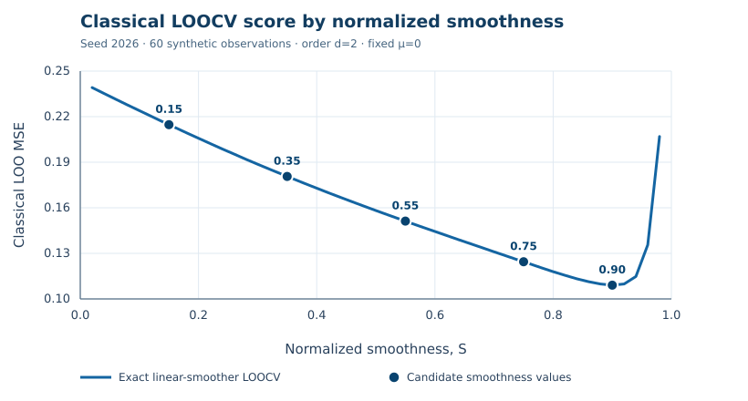

.. _smoothness-optimization:

Smoothing-parameter optimization
================================

This guide explains finite-difference penalized least squares,
normalized smoothness, ordinary cross-validation, numerical
optimization and inversion. Examples use deterministic synthetic
data, not live downloads. Methods under development by other agents
are identified as **theory**, not publicly implemented APIs.

.. contents:: Contents
   :local:
   :depth: 2

Model and notation
------------------

Let :math:`y\in\mathbb R^n` be observations at equally spaced times;
:math:`D_d\in\mathbb R^{(n-d)\times n}` is the forward difference
operator of order :math:`0\le d<n`, :math:`\mu` is a reference
mean for order-:math:`d` differences, and :math:`\lambda\ge0`
is the penalization strength. The fitted trend minimizes

.. math::
   :label: pls-objective

   \widehat\tau_\lambda
   =\arg\min_{\tau\in\mathbb R^n}
      \left\{\|y-\tau\|_2^2+
      \lambda\|D_d\tau-\mu\mathbf 1\|_2^2\right\}.

For example, :math:`(D_2\tau)_t=\tau_{t+2}-2\tau_{t+1}+\tau_t`.
At :math:`\lambda=0` the trend equals the observations. Increasing
:math:`\lambda` penalizes deviations of differences from
:math:`\mu`. At the exact :math:`\lambda=\infty` limit, the
trend is the least-squares projection onto the affine constraint
:math:`D_d\tau=\mu\mathbf1`. For :math:`d\ge1`, this is a
degree-at-most-:math:`d` polynomial, with the leading difference
controlled by :math:`\mu` (degree at most :math:`d-1` if
:math:`\mu=0`).

For **fixed numeric** :math:`\mu`, choose a vector :math:`p`
satisfying :math:`D_dp=\mu\mathbf1`, and let
:math:`Q=D_d^\top D_d`. Differentiating the objective gives

.. math::

   \widehat\tau_\lambda=p+H_\lambda(y-p),
   \qquad H_\lambda=(I+\lambda Q)^{-1}.

The symmetric matrix :math:`H_\lambda` is the **hat matrix** or
**linear smoothing matrix**. Its trace is the conditional
**effective degrees of freedom (EDF)**. For :math:`d\ge1`,
the matrix :math:`D_d` has rank :math:`n-d` and nullity
:math:`d`, so :math:`Q` has exactly :math:`d` zero eigenvalues
and :math:`n-d` positive ones. No spectral shrinkage is applied
in the polynomial nullspace.

.. important::

   The package interprets `mu="data"` as
   :math:`\mu=\operatorname{mean}(D_dy)`, not generally
   :math:`\operatorname{mean}(y)`. Ordinary CV, GCV, AICc and
   BIC in the public selector require **fixed numeric** `mu`.
   With estimated `mu`, the usual hat-matrix formula is not
   exact leave-one-out re-estimation. The displayed EDF also
   conditions on `mu`.

Normalized smoothness and Guerrero's index
------------------------------------------

Let :math:`r=n-d` and :math:`\delta_1,\ldots,\delta_r>0`
be the positive eigenvalues of :math:`Q`. The normalized
smoothness index is

.. math::
   :label: s-function

   S(\lambda)
   =\frac{n-\operatorname{tr}(H_\lambda)}{n-d}
   =\frac1r\sum_{j=1}^r
    \frac{\lambda\delta_j}{1+\lambda\delta_j}.

Its exact derivative is

.. math::
   :label: s-derivative

   S'(\lambda)=\frac1r\sum_{j=1}^r
        \frac{\delta_j}{(1+\lambda\delta_j)^2}>0.

Every term is positive at finite :math:`\lambda\ge0`.
Consequently, :math:`S` is continuous and strictly increasing,
with :math:`S(0)=0` and :math:`S(\infty)=1`.
The ranges differ: :math:`S\in[0,1]` is an interpretable
**coordinate**, whereas :math:`\lambda\in[0,\infty]` is the
actual penalty. A target of :math:`S=0.8` is **not**
80% forecast confidence or interval coverage.

Guerrero's (2007) original index instead divides by :math:`n`:

.. math::

   S_G(\lambda)=1-\frac{\operatorname{tr}(H_\lambda)}n
   =\frac{n-d}{n}S(\lambda)
   \in[0,(n-d)/n].

Use `smoother.smoothness(lambda_)` for normalized
smoothness and `smoother.smoothness(lambda_, normalized=False)`
for the original denominator. For :math:`d>0`, the original
index cannot reach 1.

Because :math:`S` is strictly increasing, the continuous
optimization problem is invariant under reparameterization:

.. math::

   \arg\min_{\lambda\in[0,\infty]} C(\lambda)
   \longleftrightarrow
   \arg\min_{s\in[0,1]} C(S^{-1}(s)).

Finite **uniform smoothness** and **log-penalty** grids
sample different sets, however. Their discretized minima
can differ even though the exact optimum does not.

Classical leave-one-out cross-validation
----------------------------------------

To evaluate ordinary LOOCV, remove one observation from the
data-fidelity term, refit with the same difference penalty and
fixed :math:`\mu`, predict the omitted value, and average
squared prediction errors. Let
:math:`r=(I-H_\lambda)(y-p)` be **training residuals**,
:math:`h_i=(H_\lambda)_{ii}` the **leverage**, and
:math:`e_i^{(-i)}` the held-out prediction error.
The exact linear-smoother shortcut is

.. math::
   :label: loo

   e_i^{(-i)}
    =y_i-\widehat y_i^{(-i)}
    =\frac{r_i}{1-h_i},
   \qquad
   \mathrm{CV}(\lambda)=\frac1n
        \sum_{i=1}^n\left(\frac{r_i}{1-h_i}\right)^2.

This avoids :math:`n` explicit refits. The identity assumes
the penalty operator, its boundary convention, numeric reference
mean and :math:`\lambda` remain fixed in deletion refits.
The division becomes undefined at zero leverage denominator;
near-zero denominators cause numerical instability.

The **training residual** has seen its own observation;
a **LOO residual** has not. For :math:`m` common errors,

.. math::

   \mathrm{MSE}=\frac1m\sum_{i=1}^m e_i^2,
   \qquad
   \mathrm{RMSE}=\sqrt{\mathrm{MSE}}.

Their rankings coincide for the same set of errors, but MSE
has squared units and RMSE has the data's units.

.. warning::

   LOOCV is **not chronological**: other observations retained
   during fitting can be later than the one omitted.
   Rolling-origin or expanding-window **time-series
   cross-validation** trains only on information available at a
   given date and scores forecasts at horizon :math:`h`.
   The package's `criterion="cv"` is ordinary in-sample LOO,
   not forecast-horizon selection.

Analytical derivatives of classical CV
--------------------------------------

For fixed numeric :math:`\mu`, put :math:`z=y-p` and
:math:`Q=D_d^\top D_d`. Differentiating
:math:`(I+\lambda Q)H_\lambda=I` gives

.. math::
   :label: derivative-hat

   H_\lambda'=-H_\lambda QH_\lambda.

Because :math:`r=(I-H_\lambda)z` and
:math:`h_i=(H_\lambda)_{ii}`, it follows that

.. math::

   r'=H_\lambda QH_\lambda z,\qquad
   h_i'=-(H_\lambda QH_\lambda)_{ii}.

The quotient rule applied to :eq:`loo` gives

.. math::
   :label: derivative-loo

   \frac{d e_i^{(-i)}}{d\lambda}
    =\frac{r_i'(1-h_i)+r_i h_i'}{(1-h_i)^2},
   \qquad
   \frac{d\,\mathrm{CV}}{d\lambda}
    =\frac2n\sum_{i=1}^n e_i^{(-i)}
         \frac{d e_i^{(-i)}}{d\lambda}.

For log-penalty :math:`u=\log\lambda`,
:math:`d\mathrm{CV}(e^u)/du=\lambda\,\mathrm{CV}'(\lambda)`.
An interior differentiable minimum has zero derivative,
but a stationary point may be a local maximum or a
non-global minimum. **Analytical score evaluation or
differentiation is not an analytical minimizer.**

.. note::

   These equations describe the mathematical basis of Agent 1's
   pending work. On the inspected `main` branch of
   22 October 2026, `select_lambda` remains a **grid**
   optimizer. No derivative-selector keyword or default is
   documented here as implemented before its API is verified.

Competing selection criteria
----------------------------

Let :math:`\mathrm{RSS}=\|r\|_2^2` and
:math:`k=\operatorname{tr}(H_\lambda)`.
The implemented scores use **smaller is better**.
AICc and BIC have alternative conventions in the literature;
the table records the library's current formulas.

.. list-table:: Supported classical selectors and Gaussian MLE
   :header-rows: 1
   :widths: 15 40 45

   * - Criterion
     - Score
     - Statistical meaning
   * - `cv`
     - :math:`n^{-1}\sum_i(r_i/(1-h_i))^2`
     - Exact classical LOO for fixed numeric :math:`\mu`
   * - `gcv`
     - :math:`(\mathrm{RSS}/n)/(1-k/n)^2`
     - Substitutes average leverage for pointwise leverage
   * - `aicc`
     - :math:`\log(\mathrm{RSS}/n)+(2k+1)/(n-k-2)`
     - Small-sample correction; undefined if :math:`n-k-2\le0`
   * - `bic`
     - :math:`\log(\mathrm{RSS}/n)+k\log(n)/n`
     - Complexity penalty increasing with sample size
   * - `mle`
     - Profiled Gaussian marginal negative log-likelihood
     - Uses latent Gaussian differences, not CV or direct
       minimization of the penalized least-squares loss

In the Gaussian **marginal MLE**, let :math:`w_j` denote
the coordinates of :math:`y-p` in the positive-penalty
eigenvectors, and define :math:`c_j(\lambda)=
1+1/(\lambda\delta_j)`. With independent Gaussian
observation errors of variance :math:`\sigma_\varepsilon^2`,
Gaussian latent differences of variance
:math:`\sigma_\eta^2`, and
:math:`\lambda=\sigma_\varepsilon^2/\sigma_\eta^2`,
the profiled score (up to constants) is

.. math::

   L_{\mathrm{profile}}(\lambda)
    =r\log\left(\frac1r\sum_{j=1}^r
                 \frac{w_j^2}{c_j(\lambda)}\right)
     +\sum_{j=1}^r\log c_j(\lambda).

The unpenalized polynomial coordinates are treated as
nuisance components (REML-style). MLE rejects
:math:`\lambda=0` (improper latent prior) and structurally
unidentified cases :math:`d=0` or :math:`r<2`.
Unlike the classical criteria, it accepts `mu="data"`,
but **conditions** on the observed-difference mean:
this is not joint maximum likelihood over :math:`\mu`.
See :doc:`mathematics` and :doc:`api/variances`.

Numerical optimization and global minima
----------------------------------------

Currently, `select_lambda(..., grid=None)` evaluates
**121 geometric candidate penalties**, scaled by the
median positive eigenvalue, and also the exact
:math:`\lambda=\infty` limit. A user may provide
an explicit array via `grid=`. This is a finite
search, not a guarantee about an unexamined continuum.

.. list-table:: Methods and trade-offs
   :header-rows: 1
   :widths: 27 35 38

   * - Method
     - Benefit
     - Risk
   * - Logarithmic penalty grid
     - Spans many penalty orders of magnitude
     - Can miss a narrow minimum; add :math:`0,\infty`
   * - Uniform smoothness grid
     - Uniformly covers the bounded :math:`S` coordinate
     - Uneven penalty-space resolution
   * - Analytical CV derivative
     - Finds candidate stationary points efficiently
     - Roots are not necessarily global minima
   * - Local numerical refinement
     - Increases precision near a promising candidate
     - Only local unless extra assumptions hold
   * - Multiple candidate basins
     - Compare objective values after refining each basin
     - A finite scan cannot rigorously exclude missed basins
   * - Boundary evaluation
     - Considers exact :math:`\lambda=0,\infty` limits
     - Some criteria are undefined there

A defensible workflow scans a broad log-penalty range,
locates low-score basins and derivative sign changes,
refines multiple candidates, evaluates **objective values**
at refined points and admissible boundaries, and repeats
after enlarging the interval. Report the numerical tolerance.
Simply solving :math:`\mathrm{CV}'(\lambda)=0` does
**not** establish a global minimum.

Smoothness inversion: Brent, Newton, secant
------------------------------------------

Given :math:`s\in(0,1)`, define
:math:`F(\lambda)=S(\lambda)-s`. Equation
:eq:`s-derivative` proves the root is unique.
The shipped `TrendSmoother.lambda_for_smoothness(s)`
repeatedly doubles a bracket's upper endpoint and
calls SciPy's bracketed **Brent `brentq`** algorithm.

* **Newton–Raphson:** :math:`\lambda_{k+1}=
  \lambda_k-F(\lambda_k)/S'(\lambda_k)`.
  It converges locally quickly but may step negative.
* **Secant:** approximate the derivative from the preceding
  two iterates; no derivative is required, but the step need
  not stay in the domain.
* **Bracket-preserving fallback:** if an open iteration fails,
  retain an interval with a sign change and use a validated
  bracketed solver. The specific future fallback policy is
  not yet part of the confirmed public API.

Endpoint inversion is exact:
:math:`s=0\mapsto\lambda=0` and
:math:`s=1\mapsto\lambda=\infty`.
With `normalized=False`, the upper valid target is
:math:`(n-d)/n`. Only **Brent** is currently confirmed as a
library method; Newton and secant below are demonstrated by
calling **SciPy**, rather than inventing Agent 2 method names.

Runnable Python: default CV, legacy grid, GCV
------------------------------------------------

All snippets use seeded synthetic values and the **confirmed**
interface on the inspected main branch. To install the source and
documentation dependencies, run `python -m pip install -e ".[docs,plot]"`.
The present default is **grid CV**; a planned derivative-based
default must be documented after Agent 1's merge.

.. code-block:: python

   import numpy as np
   from trendestimation import TrendSmoother, select_lambda

   rng = np.random.default_rng(2026)
   t = np.arange(60, dtype=float)
   y = (0.035 * t + 0.7 * np.sin(t / 8.0)
        + 0.35 * np.cos(t / 17.0)
        + rng.normal(0.0, 0.33, len(t)))
   smoother = TrendSmoother(len(y), order=2)

   default_cv = select_lambda(
       smoother, y, criterion="cv", mu=0.0
   )
   legacy_grid = np.r_[np.geomspace(1e-4, 1e5, 180), np.inf]
   grid_cv = select_lambda(
       smoother, y, criterion="cv", mu=0.0, grid=legacy_grid
   )
   gcv = select_lambda(
       smoother, y, criterion="gcv", mu=0.0
   )
   for selected in (default_cv, grid_cv, gcv):
       print(selected.criterion, selected.lambda_,
             selected.smoothness, selected.score)

   trend = smoother.fit(
       y, lambda_=default_cv.lambda_, mu=0.0
   ).trend

Notice that `select_lambda` returns the selected penalty
in `lambda_` and its score in `score`, while `scores`
and `grid` contain the evaluated candidates. The
explicit grid reproduces the existing grid-search API;
it does **not** guess a new future `optimizer=` option.

Runnable Python: numerical root-finder comparison
--------------------------------------------------

The package's root inversion is shown first. The additional
methods are **SciPy** public algorithms, **not** hypothetical
options to `lambda_for_smoothness`.

.. code-block:: python

   import numpy as np
   from scipy.optimize import brentq, newton, root_scalar
   from trendestimation import TrendSmoother, difference_matrix

   smoother = TrendSmoother(60, order=2)
   target = 0.75
   library_root = smoother.lambda_for_smoothness(target)

   # D D^T has exactly n-d positive eigenvalues.
   D = difference_matrix(60, 2)
   delta = np.linalg.eigvalsh(D @ D.T)

   def f(lam):
       return smoother.smoothness(lam) - target

   def derivative(lam):
       return np.mean(delta / (1.0 + lam * delta)**2)

   upper = 1.0
   while f(upper) < 0:
       upper *= 2.0

   roots = {
       "Library Brent": library_root,
       "SciPy Brent": brentq(f, 0, upper),
       "SciPy Newton": newton(
           f, x0=upper / 2, fprime=derivative
       ),
       "SciPy secant": root_scalar(
           f, x0=upper / 5, x1=0.3 * upper,
           method="secant"
       ).root,
   }
   for name, root in roots.items():
       print(name, root, abs(f(root)))
       assert root >= 0 and abs(f(root)) < 1e-8

   assert smoother.lambda_for_smoothness(0.0) == 0
   assert np.isinf(smoother.lambda_for_smoothness(1.0))

These initial guesses work on this **specific** example;
general-purpose Newton and secant implementations need domain
checks, iteration limits and a bracket fallback.

Visual demonstration: smoothness versus CV MSE
-----------------------------------------------

The following figure uses 60 synthetic observations, difference
order 2, fixed `mu=0` and seed 2026. The graph shows 49
normalized smoothness candidates and highlights five of them.
**Smaller CV MSE is better** for this in-sample score.

   **Synthetic classical LOOCV example.** The five highlighted
   candidates are :math:`S=0.15,0.35,0.55,0.75,0.90`.
   Minimum displayed MSE occurs near :math:`S=0.90`.
   The shape is data-dependent and not a forecast result.

Run `python docs/examples/smoothness_optimization.py` to
regenerate the figure, inspect the selected penalty values,
compare default CV with GCV and review the candidate table.
The script writes only to `docs/_static/figures/` when
explicitly invoked (not as part of automatic documentation builds).

.. literalinclude:: examples/smoothness_optimization.py
   :language: python
   :caption: Generate the validation-error-versus-smoothness plot
   :linenos:

Scientific scope, limitations and sources
-----------------------------------------

Analytical LOO formulae require fixed numeric :math:`\mu`,
unchanged differencing conventions, and a fixed linear
smoother for each :math:`\lambda`. Search tolerances,
conditioning, excluded boundary solutions and the extent
of the scanned domain affect numerical results. An MLE
criterion is meaningful only under its assumed stochastic
model. Do not conflate in-sample smoothness selection
with selection for future forecast horizons.

See :doc:`mathematics` for the complete mathematical
conventions, :doc:`api/selection` for current signatures,
:doc:`quickstart` for an introductory workflow and
:doc:`references` for the full bibliography.

* Guerrero (2007), *Time series smoothing by penalized least squares*:
  https://doi.org/10.1016/j.spl.2007.03.006
* Cortés-Toto, Guerrero and Reyes (2017), *Trend smoothness achieved
  by penalized least squares with the smoothing parameter chosen
  by optimality criteria*: https://doi.org/10.1080/03610918.2015.1005236
* Weinert (2007), *Efficient computation for Whittaker–Henderson smoothing*:
  https://doi.org/10.1016/j.csda.2006.11.038
* Biessy (2026), *Whittaker–Henderson smoothing revisited*:
  https://doi.org/10.1017/asb.2025.10061
