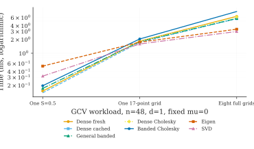
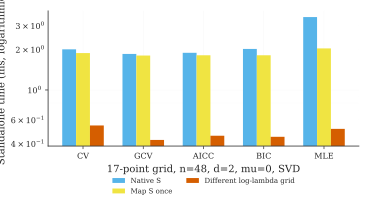
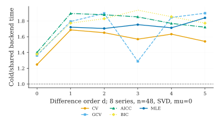
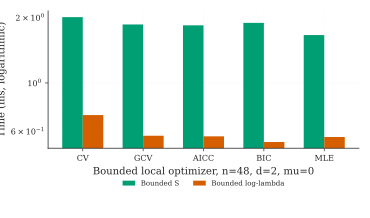
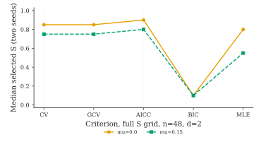

Full Windows experiment: 80,640 measured searches
===================================================

This is the **author's complete Windows full-preset experiment**, not
the earlier GitHub-hosted Linux quick benchmark. The original source
contains 80,640 recorded searches with seven backends, CV/GCV/AICc/BIC
and conditional Gaussian MLE, difference orders 0 to 5, fixed
reference means :math:`\mu=0` and :math:`\mu=0.15`, sample sizes
24 and 48, and one, three or eight independent series.
The measurements use seven timing repetitions and one BLAS thread,
with two recorded experimental seeds.

The source data and environment were uploaded to GitHub without
changing numerical results. The published figures are derived from
these files and all reported medians combine the two actual seeds.

.. include:: windows_full_s_generated.rst

One computation, one complete grid, and eight repeated searches
---------------------------------------------------------------

These are distinct computational tasks. Backend preparation may be
amortized across multiple series, while a single evaluation has
different preparation costs. Only solver methods numerically valid
in both seeds are displayed. The vertical axis is logarithmic.

Direct S, translated S-to-lambda, and a different lambda grid
---------------------------------------------------------------

The direct S-grid and once-converted S-to-lambda grid evaluate the
**same 17 candidate penalties**. They must agree statistically.
Premapping costs time once, but the conversion can be shared by
every method and criterion. The log-lambda grid has different
interior candidates despite identical extreme finite bounds.

Cold versus shared preparation over eight independent series
-------------------------------------------------------------

This panel uses the backend-only duration, excluding a one-time
S-to-lambda grid inversion. Reusing the same factorization structure
across independent observed series is not the same as reusing one
Cholesky factorization across **different** penalties.

Bounded S and log-lambda optimization
-------------------------------------

These are measured *local bounded scalar searches*, not guaranteed
global minimization. They may evaluate different points and use
different numbers of criterion calls. They must therefore not be
confused with evaluating the full fixed 17-point grid.

Effects of a nonzero fixed reference mean
-----------------------------------------

The mean :math:`\mu` is **fixed**, not jointly estimated with the
smoothing parameter. Gaussian MLE is not applicable at difference
order zero under the current adopted model. Exact :math:`S=1`
corresponds to :math:`\lambda=\infty` and is handled analytically.

Provenance and reproducibility
------------------------------

The original uploaded input paths are:

- `paper/benchmarks/results/full_s_search_modes/search_mode_timings.csv`
- `paper/benchmarks/results/full_s_search_modes/search_grid_preparation.csv`
- `paper/benchmarks/results/full_s_search_modes/environment.json`

Derived, reproducible output paths:

- `paper/benchmarks/windows_full_s_analysis/two_seed_aggregates.csv`
- `paper/benchmarks/windows_full_s_analysis/paired_grid_costs.csv`
- `paper/benchmarks/windows_full_s_analysis/selected_s.csv`
- `paper/benchmarks/windows_full_s_analysis/validation.json`

The script is `paper/benchmarks/report_windows_full_s.py`.
It validates all experimental axes, compares results from the
identical candidate grids, builds the tables, and renders PDF/SVG
figures with pinned AwesomeFigures.

These results describe the user's Windows workstation and must
not be pooled with Linux-hosted timing figures. In-sample
criterion comparisons do not demonstrate superior chronological
forecasting performance.

See :doc:`full_s_factorial` for the previous complete-domain
numerical-validity benchmark and :doc:`mle_coordinate_figures`
for the separate search-coordinate comparison.
