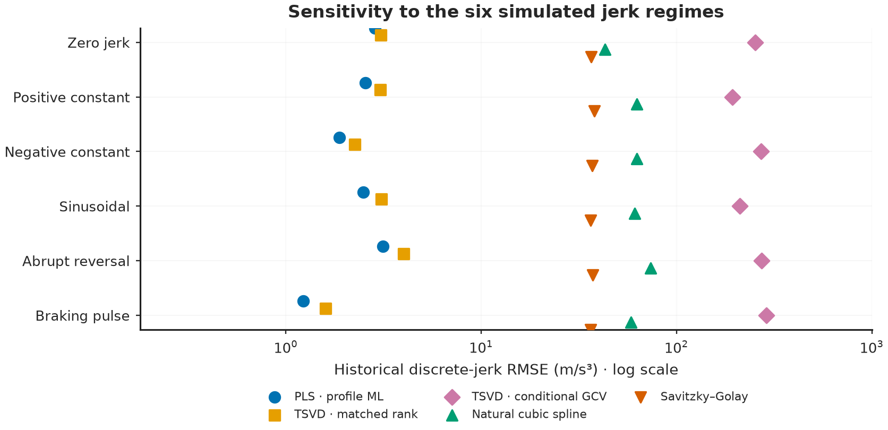
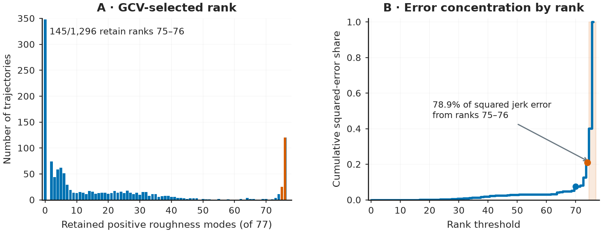
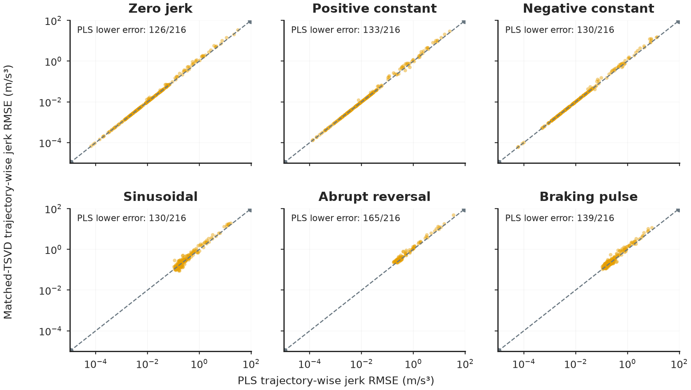
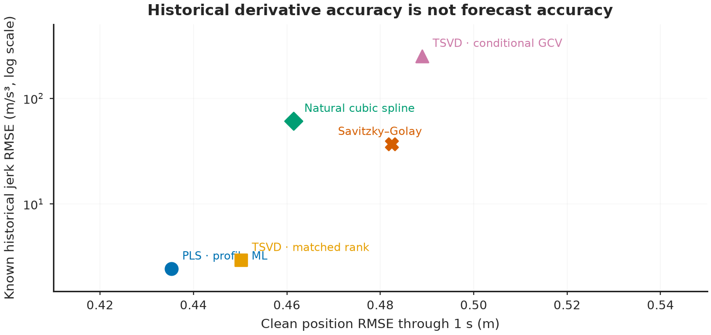
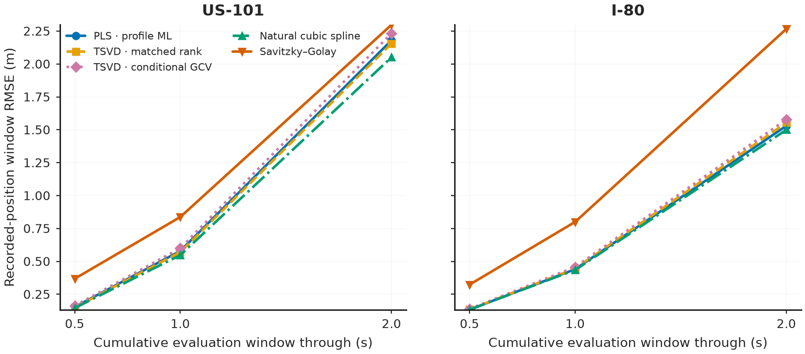
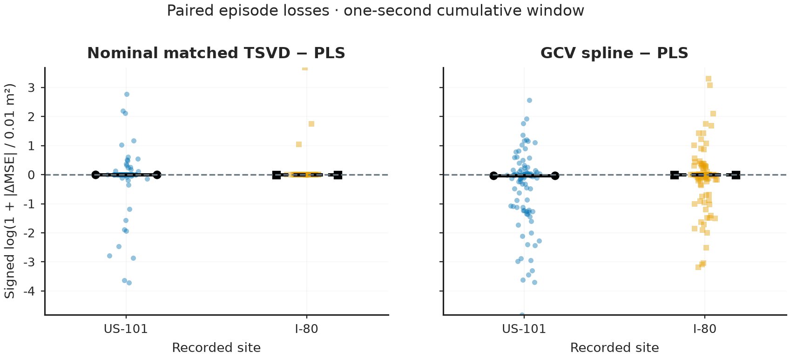
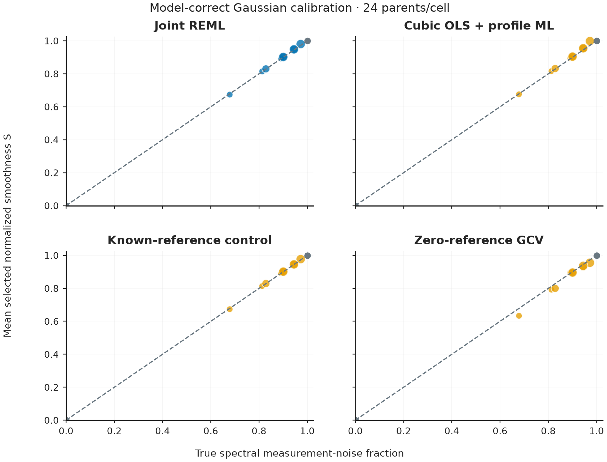
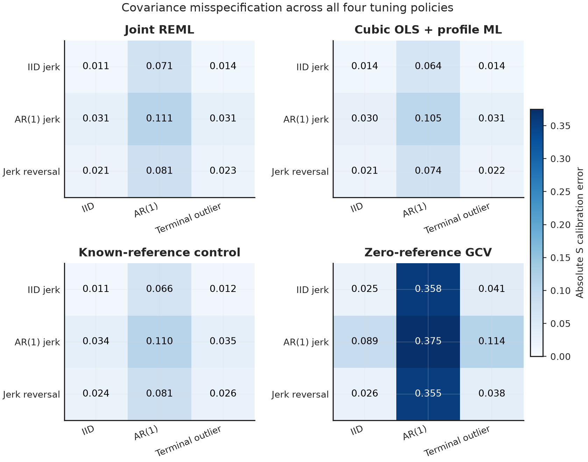
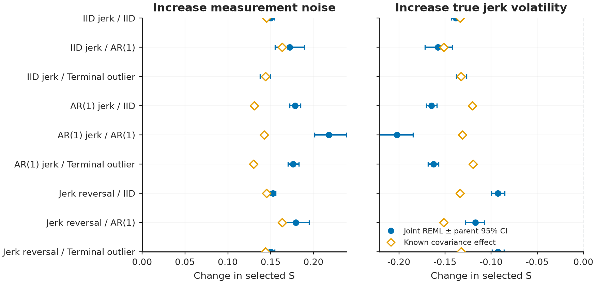
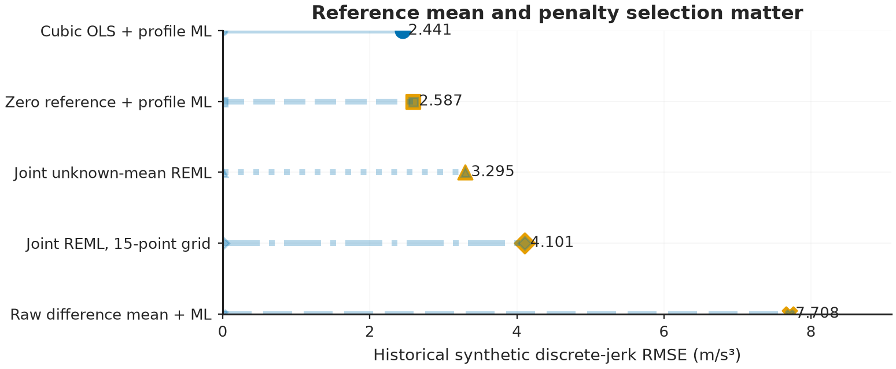

# Paper C — AwesomeFigures gallery

**Status:** Ten supplementary, source-verified scientific figure groups, plus six restyled Experiment006/007 and two restyled Experiment008 figure groups. All figures are reproducible from the completed, immutable result branches; none supplies independently observed NGSIM physical jerk.

**Documents:** [Primary manuscript](main.pdf) · [12-page illustrated supplement](atlas_supplement.pdf) · [Figure sources and reproducibility](visuals/README.md) · [Renderer](visuals/render_awesomefigures_atlas.py) · [SHA-256 manifest](generated/awesomefigures_atlas_manifest.json).

Every atlas graphic has a print/vector [PDF], an editable [SVG], and a preview [PNG] at the same stem under `figures/`. The images below are previews; the manuscript uses vector PDFs.

## A1. known jerk regimes

Historical known-jerk recovery by six physical motion regimes.

[Vector PDF](figures/atlas_known_jerk_regimes.pdf) · [Editable SVG](figures/atlas_known_jerk_regimes.svg) · [PNG](figures/atlas_known_jerk_regimes.png)

## A2. tsvd rank pathology

Conditional TSVD-GCV rank distribution and concentration of derivative error.

[Vector PDF](figures/atlas_tsvd_rank_pathology.pdf) · [Editable SVG](figures/atlas_tsvd_rank_pathology.svg) · [PNG](figures/atlas_tsvd_rank_pathology.png)

## A3. paired jerk losses

Trajectory-paired PLS versus nominally EDF-matched TSVD loss.

[Vector PDF](figures/atlas_paired_jerk_losses.pdf) · [Editable SVG](figures/atlas_paired_jerk_losses.svg) · [PNG](figures/atlas_paired_jerk_losses.png)

## A4. method tradeoff

Distinction between clean future-position RMSE and known historical jerk recovery.

[Vector PDF](figures/atlas_method_tradeoff.pdf) · [Editable SVG](figures/atlas_method_tradeoff.svg) · [PNG](figures/atlas_method_tradeoff.png)

## A5. ngsim by site

Common-continuation forecasts split by US-101 and I-80.

[Vector PDF](figures/atlas_ngsim_by_site.pdf) · [Editable SVG](figures/atlas_ngsim_by_site.svg) · [PNG](figures/atlas_ngsim_by_site.png)

## A6. ngsim paired delta

Recorded NGSIM episode-level paired MSE differences; descriptive only.

[Vector PDF](figures/atlas_ngsim_paired_delta.pdf) · [Editable SVG](figures/atlas_ngsim_paired_delta.svg) · [PNG](figures/atlas_ngsim_paired_delta.png)

## A7. spectral calibration grid

Correct-model covariance-fraction calibration for four tuning policies.

[Vector PDF](figures/atlas_spectral_calibration_grid.pdf) · [Editable SVG](figures/atlas_spectral_calibration_grid.svg) · [PNG](figures/atlas_spectral_calibration_grid.png)

## A8. misspecification matrix

Absolute calibration error across jerk and observation-noise structures.

[Vector PDF](figures/atlas_misspecification_matrix.pdf) · [Editable SVG](figures/atlas_misspecification_matrix.svg) · [PNG](figures/atlas_misspecification_matrix.png)

## A9. noise jerk interventions

Archived paired-parent increases in observation noise versus genuine jerk volatility.

[Vector PDF](figures/atlas_noise_jerk_interventions.pdf) · [Editable SVG](figures/atlas_noise_jerk_interventions.svg) · [PNG](figures/atlas_noise_jerk_interventions.png)

## A10. reference policy

Reference-mean and smoothing-criterion sensitivity from Experiment006.

[Vector PDF](figures/atlas_reference_policy.pdf) · [Editable SVG](figures/atlas_reference_policy.svg) · [PNG](figures/atlas_reference_policy.png)

## Interpreting the graphical evidence

Historical discrete jerk RMSE uses clean synthetic trajectories and the same third-difference operator applied to fits and latent truth. PLS/TSVD matched ranks use **nominal fixed-reference** degrees of freedom; TSVD conditional-GCV is not exact full-estimator GCV. Real NGSIM trajectories do **not** have independently observed jerk. Horizon H RMSE includes **all frames 1,...,H**, not the final frame alone. The 200 recorded episodes share recording-time blocks and some vehicle identifiers. Experiment007's 1,944 factorial cases derive from **72 independent random parents**. S is a model-conditional, relative noise fraction, not absolute sensor precision. The independent GCV spline plus Taylor continuation remains best on some real recorded-position comparisons and is retained in the main manuscript.

**Archive requirements:** Preserve original Experiment004–008 outputs, all new figure/manifest files and compiled documents; do not silently overwrite previous result branches. See `visuals/README.md` and `notes/SCIENCE_EDITORIAL_REVIEW.md` for the independent-agent handoff.
