<!-- _class: lead -->
# Trend estimation by penalized least squares

## From the penalty $\lambda$ to interpretable smoothness $S\in[0,1]$

### Theory · numerical computation · selection criteria · open problems

Heriberto Espino-Montelongo · Daniela Cortés-Toto  
Universidad de las Américas Puebla

*Extended research-lecture notebook for discussion with the professor.*

---

<!-- _class: compact -->
# What the full lecture investigates

**A mathematical and computational research notebook — intentionally extensive.**

1. Motivation and the established PLS estimator.
2. Arbitrary finite-difference orders and reference means.
3. Affine solution, polynomial nullspace, SVD and cost.
4. **Normalized smoothness $S\in[0,1]$ as an interpretable selection coordinate.**
5. Equivalent penalty and smoothness searches, their derivatives and costs.
6. CV, GCV, AICc, BIC, Gaussian MLE and a deferred joint mean.
7. Fair runtime benchmarks, numerical conditioning and scientific examples.
8. What is new, what is known, and where research can continue.

**Legend:** established theory · implemented methods · tested numerical claims · future research.

---

<!-- _class: math -->
# The central question in three formulas

**Can we search in normalized smoothness instead of raw penalty units?**

$
\boxed{s=S(\lambda)=\frac{n-\operatorname{tr}(H_\lambda)}{n-d}
\in[0,1].}
$

$
\boxed{
\widehat s\in\arg\min_{s\in[0,1]}
C(S^{-1}(s);\mu),\qquad
\widehat\lambda=S^{-1}(\widehat s).
}
$

**Same fitted trends and criterion; a different optimization coordinate.**

*Computational question: is the interpretability worth the inversion cost?*

---

<!-- _class: chapter -->
# I. Why estimate a trend?

## From noisy observations to a structured, interpretable signal

---

<!-- _class: fig -->
# Observed data versus latent signal

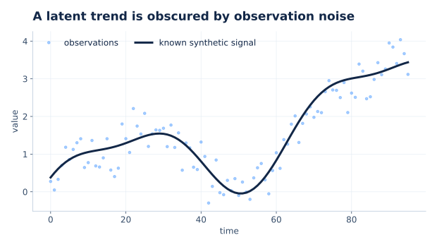

*Deterministic synthetic data; truth is known only because the example is simulated.*

---

<!-- _class: math -->
# The fundamental observation model

$$y_t=\tau_t+\varepsilon_t,\qquad t=0,\ldots,n-1.$$

- $y_t$: observation.
- $\tau_t$: smooth latent component that we want to estimate.
- $\varepsilon_t$: remainder, not necessarily white noise.

**Our paper studies historical trend extraction, not demonstrated forecasting skill.**

---

<!-- _class: fig -->
# Fidelity to observations

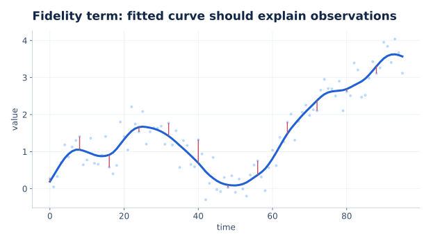

*Squared vertical discrepancies contribute to the data-fidelity term.*

---

<!-- _class: fig -->
# Why we also penalize roughness

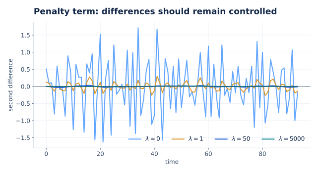

*The penalty is evaluated on differences of the FITTED series, not observations.*

---

<!-- _class: math -->
# The single mathematical object behind this project

$$\boxed{
\widehat\tau_{\lambda,\mu}
=\arg\min_{\tau\in\mathbb R^n}
\left\{\|y-\tau\|^2+\lambda\|D_d\tau-\mu\mathbf1\|^2\right\}.
}$$

**Hyperparameters:** order $d$, reference mean $\mu$, penalty $\lambda\ge0$.

At $\lambda=0$ the model interpolates. As $\lambda\to\infty$ it approaches the affine difference constraint.

**This PLS family is established theory; the library is not claiming to invent it.**

---

<!-- _class: fig -->
# How the penalty alters the trend

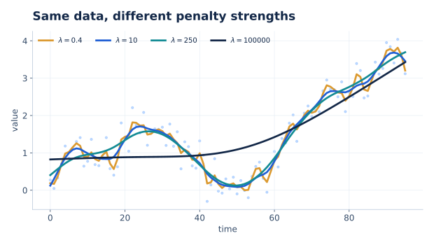

*Same synthetic series; multiple positive penalties.*

---

<!-- _class: compact -->
# Historical contributions and attribution

| Work | Established idea |
| --- | --- |
| Whittaker | Graduation using penalized differences |
| Guerrero | Reference differences and controlled smoothness |
| Cortés-Toto et al. | CV, GCV, AICc, BIC comparisons for PLS |
| Whittaker–Henderson literature | Banded computation, likelihood interpretation |
| Our project | Integrated implementation, analytical derivatives, safe numerical inversion, $S$ search, reproducibility |

**Arbitrary order $d$, nonzero $\mu$, polynomial nullspaces and spectral PLS are not individually new.**

---

<!-- _class: chapter -->
# II. Understanding difference operators

## What does the penalty actually enforce?

---

<!-- _class: math -->
# First difference operator

$$D_1\tau=
(\tau_1-\tau_0,\tau_2-\tau_1,\ldots)^\top.$$

When $d=1$ and $\mu=0$, large $\lambda$ discourages changes between adjacent levels.

$$\lim_{\lambda\to\infty}\widehat\tau_{\lambda,0}
=\text{best constant fit.}$$

---

<!-- _class: fig -->
# Visualizing first differences

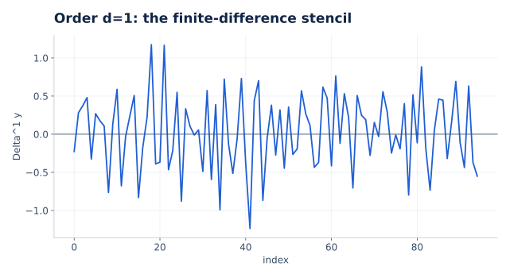

*First differences measure consecutive level changes.*

---

<!-- _class: math -->
# Second differences measure curvature

$$
(D_2\tau)_t=\tau_{t+2}-2\tau_{t+1}+\tau_t.
$$

$$
D_2=\begin{pmatrix}
1&-2&1&0&\cdots\\
0&1&-2&1&\cdots\\
\vdots&&\ddots&&
\end{pmatrix}.
$$

A large centered second-difference penalty gives a **linear** limiting fit.

---

<!-- _class: fig -->
# Visualizing second differences

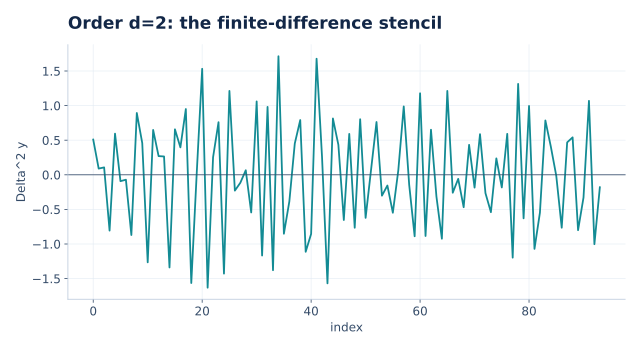

*Second differences detect local changes of slope.*

---

<!-- _class: math -->
# Any admissible integer difference order

$$
\boxed{
(D_d\tau)_t=\sum_{k=0}^d(-1)^{d-k}\binom{d}{k}\tau_{t+k}.
}
$$

Examples: $D_1=(-1,1)$; $D_2=(1,-2,1)$; $D_3=(-1,3,-3,1)$.

The implementation also handles $d=0$, for which $D_0=I_n$.

**Numerical admissibility and floating-point reliability are different statements.**

---

<!-- _class: fig -->
# Third differences

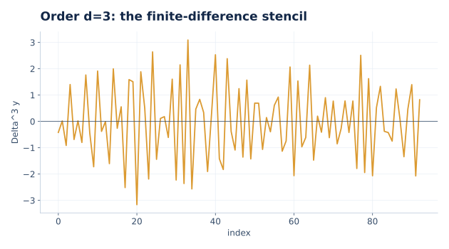

*Third differences react to variation in curvature.*

---

<!-- _class: fig -->
# Higher-order binomial stencils

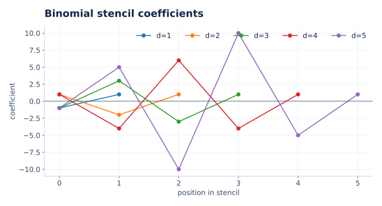

*Large coefficients contribute to high-order numerical conditioning problems.*

---

<!-- _class: fig -->
# A sparse banded difference operator

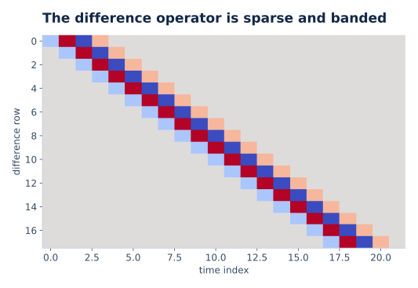

*Its structure is why banded linear solvers are strong baselines.*

---

<!-- _class: math -->
# Proof: why exactly d zero eigenvalues?

For $1\le d<n$, $D_d$ has $n-d$ independent rows:

$$\operatorname{rank}(D_d)=n-d.$$

Let $Q_d=D_d^\top D_d$. Since

$$x^\top Q_dx=\|D_dx\|^2,$$

we have $\ker Q_d=\ker D_d$. Consequently,

$$\boxed{\dim\ker Q_d=d.}$$

The result is exact algebra; numerical rank thresholds are a separate matter.

---

<!-- _class: fig -->
# What is in the nullspace?

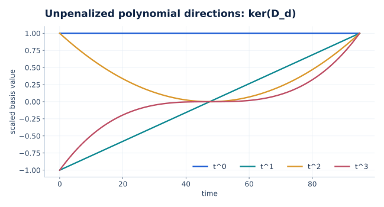

*The basis 1, t, ..., t^(d-1) is annihilated by d-th differences.*

---

<!-- _class: fig -->
# Zero-mean infinite-penalty limits

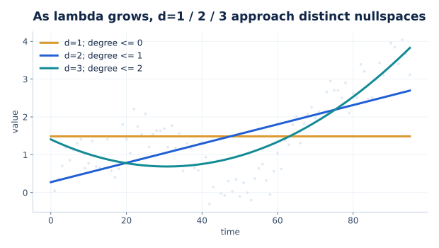

*Constant for d=1, linear for d=2, quadratic for d=3.*

---

<!-- _class: math -->
# The nonzero mean difference is important

At infinite penalty,

$$\boxed{D_d\tau=\mu\mathbf1.}$$

With zero-based indices one particular solution is

$$p_t=\mu\binom td,\qquad D_dp=\mu\mathbf1.$$

Every limiting curve has form

$$\tau=p+q,\quad q\in\ker D_d.$$

Thus $\mu\ne0$ allows a **degree-d** polynomial component, instead of only degree at most $d-1$. This property is established, but computationally useful.

---

<!-- _class: fig -->
# Change the reference mean, keep order and penalty

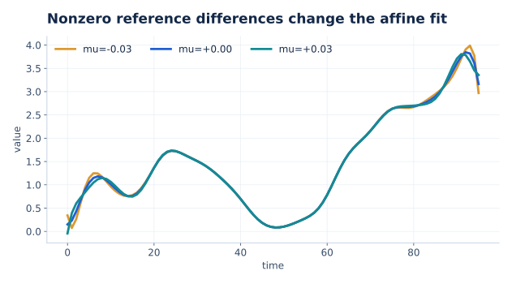

*The reference shifts the affine trend estimate.*

---

<!-- _class: fig -->
# The affine infinite-penalty limit for nonzero mu

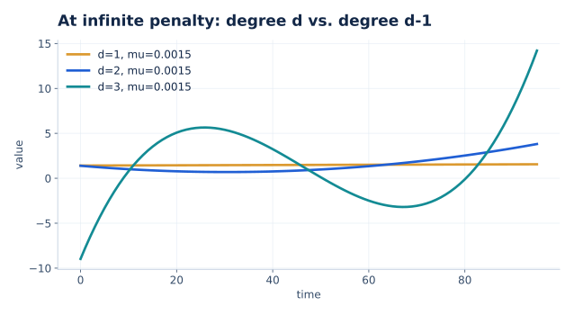

*Degree-d particular solution plus the d-dimensional nullspace.*

---

<!-- _class: compact -->
# Fixed mu, empirical plug-in, and future joint estimation

| Mean | Meaning | Status |
| --- | --- | --- |
| $\mu=0$ | Centered penalty | Implemented |
| Numeric $\mu\ne0$ | Prespecified mean differences | Implemented |
| $\mu=\operatorname{mean}(D_dy)$ | Observed-difference plug-in | Implemented in fitting and conditional MLE |
| $\widehat\mu(\lambda)$ | Conditional likelihood-optimal mean | Derived, joint method not released |

**Data-derived mu is not automatically a joint maximum-likelihood estimate.**

---

<!-- _class: chapter -->
# III. Deriving the affine estimator

## From the quadratic problem to a reusable matrix

---

<!-- _class: math -->
# Eliminate the reference mean from the penalty

Take $p$ with $D_dp=\mu\mathbf1$ and set $x=\tau-p$.

$$
\widehat x=\arg\min_x
\left\{\|(y-p)-x\|^2+\lambda\|D_dx\|^2\right\}.
$$

The remaining penalty is centered around zero. The shift $p$ is explicitly known.

---

<!-- _class: math -->
# Differentiate the quadratic

With $Q_d=D_d^\top D_d$,

$$
\nabla_x=-2(y-p-x)+2\lambda Q_dx.
$$

Setting $\nabla_x=0$:

$$(I+\lambda Q_d)\widehat x=y-p.$$

Therefore,

$$
\boxed{\widehat\tau_{\lambda,\mu}=p+H_\lambda(y-p),\quad
H_\lambda=(I+\lambda Q_d)^{-1}.}
$$

---

<!-- _class: math -->
# Derivative of the smoothing matrix

From $(I+\lambda Q_d)H_\lambda=I$,

$$Q_dH_\lambda+(I+\lambda Q_d)H_\lambda'=0.$$

Hence

$$\boxed{H_\lambda'=-H_\lambda Q_dH_\lambda.}$$

This exact matrix identity is central to gradients of leverage, residuals and CV.

---

<!-- _class: compact -->
# Meaning of H and its trace

For fixed numeric $\mu$,

$$\widehat\tau=p+H_\lambda(y-p).$$

- $H_\lambda$ is symmetric and positive definite at finite $\lambda$.
- Eigenvalues lie in $(0,1]$.
- Diagonal $h_{ii}$ gives the observation-space leverage.
- Trace $\nu(\lambda)$ is the **conditional effective degrees of freedom**.

If $\mu$ depends on the data, the full fitted-value sensitivity changes.

---

<!-- _class: fig -->
# Weak and strong hat matrices

<div class="pair">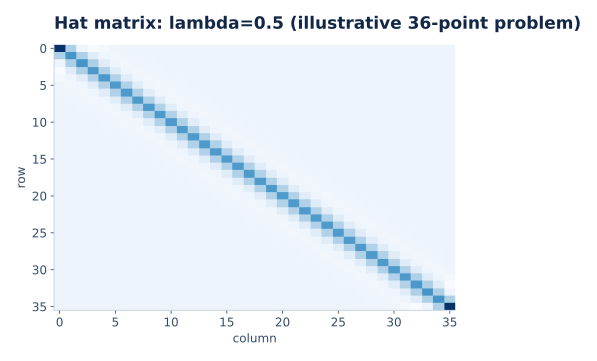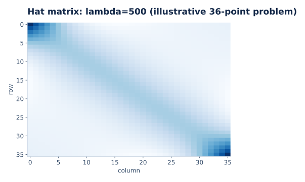</div>

*Observation-space H is generally dense, while the spectral attenuation matrix is diagonal.*

---

<!-- _class: chapter -->
# IV. Spectral computation

## The value of precomputing once and reusing many times

---

<!-- _class: math -->
# Diagonalize the penalty

$$D_d=U\Sigma V^\top,\qquad
Q_d=V\operatorname{diag}(\delta_j)V^\top.$$

Then

$$
\boxed{
H_\lambda=V\operatorname{diag}\left(
\frac{1}{1+\lambda\delta_j}\right)V^\top.
}
$$

The eigenvectors do not change when $\lambda$ changes.

---

<!-- _class: fig -->
# The positive penalty spectrum

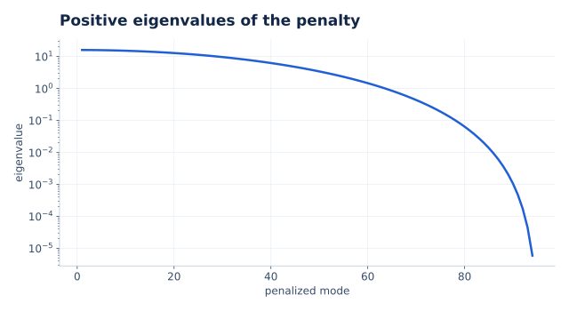

*Positive eigenvalues δ_j for a seeded order-two example.*

---

<!-- _class: fig -->
# Attenuation of different spectral modes

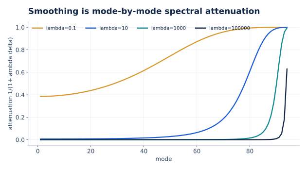

*Each mode is multiplied by 1/(1+lambda δ_j).*

---

<!-- _class: math -->
# One projection, many candidate penalties

Compute $c=V^\top(y-p)$ once.

Then

$$
\boxed{
\widehat\tau_{\lambda,\mu}=
p+V\operatorname{diag}(\alpha_j(\lambda))c,
\quad\alpha_j(\lambda)=\frac{1}{1+\lambda\delta_j}.
}
$$

The costly eigensystem is reusable, but reconstructing a full fitted curve still takes matrix–vector operations.

---

<!-- _class: compact -->
# Cost accounting matters

| Computational task | Leading arithmetic cost |
| --- | --- |
| Full SVD setup | $O(n^3)$ |
| Eigenvector storage | $O(n^2)$ |
| Single transformed data projection | $O(n^2)$ |
| Scalar trace / smoothness / spectral GCV | $O(n)$ per candidate |
| Full trend reconstruction | $O(n^2)$ per candidate |
| Pointwise LOOCV leverage | Typically $O(n^2)$ per candidate |

Cost is **not** identical to elapsed wall-clock time.

---

<!-- _class: math -->
# Two cheap scalar identities

For positive-mode coordinates $c_j$ and attenuation $\alpha_j$:

$$
\boxed{\nu(\lambda)
=d+\sum_{j=1}^{n-d}\alpha_j(\lambda).}
$$

$$
\boxed{
\operatorname{RSS}(\lambda)
=\sum_{j=1}^{n-d}(1-\alpha_j(\lambda))^2 c_j^2.
}
$$

These are the inputs for effective degrees of freedom and several classical scalar scores.

---

<!-- _class: fig -->
# Full fitted curves are not scalar trace queries

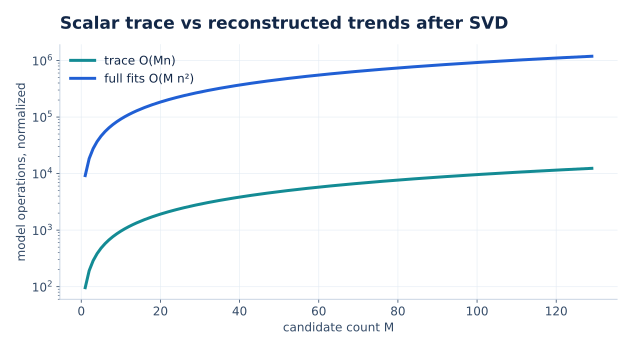

*Illustrative arithmetic growth, not measured benchmark times.*

---

<!-- _class: fig -->
# Trace and residual energy as scalar spectral summaries

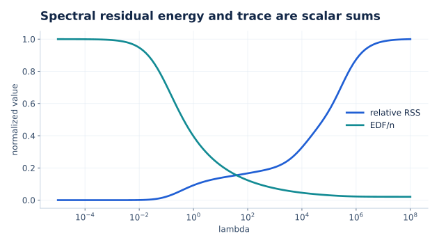

*The functions are computed from a reused spectral basis.*

---

<!-- _class: chapter -->
# V. Effective degrees of freedom

## A trace-based interpretation of smoothing intensity

---

<!-- _class: math -->
# What are effective degrees of freedom?

For fixed numerical $\mu$,

$$
\boxed{\nu(\lambda)=\operatorname{tr}(H_\lambda)
=d+\sum_{j=1}^{n-d}\frac{1}{1+\lambda\delta_j}.}
$$

With $d\ge1$, $\nu(0)=n$ and $\nu(\infty)=d$.

For $d=0$, the limiting EDF is zero.

**A data-estimated $\mu$ alters the full fitted-value sensitivity.**

---

<!-- _class: fig -->
# EDF falls with the penalty

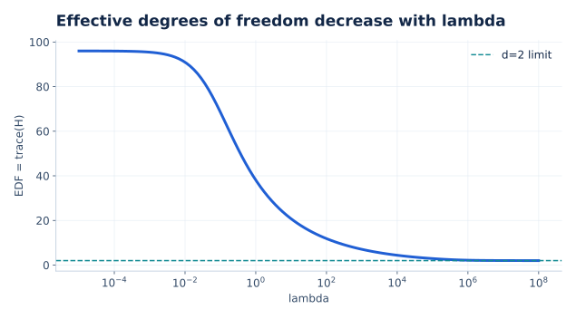

*The infinite-penalty EDF equals d, the unpenalized dimension.*

---

<!-- _class: math -->
# Guerrero's original smoothness index

$$
\boxed{
S_G(\lambda)=1-\frac{\nu(\lambda)}{n}.
}
$$

For order $d>0$, its range is

$$0\le S_G(\lambda)\le\frac{n-d}{n}.$$

Therefore the original denominator-$n$ index **does not reach one** in general.

---

<!-- _class: math -->
# Our normalized smoothness coordinate

$$
\boxed{
S(\lambda)=\frac{n-\nu(\lambda)}{n-d}
=\frac{1}{n-d}\sum_{j=1}^{n-d}
\frac{\lambda\delta_j}{1+\lambda\delta_j}.
}
$$

Now $S(0)=0$ and $S(\infty)=1$.

**Meaning:** average spectral shrinkage in the penalized directions.  
**Not:** confidence, probability of correctness, or forecast accuracy.

---

<!-- _class: math -->
# Interpret a smoothness target S = 0.8

The definition gives the **conditional effective degrees of freedom**:

$
\boxed{\nu(\lambda)=n-(n-d)S(\lambda).}
$

For $n=100$, difference order $d=2$:

| Smoothness | Conditional EDF |
| :---: | ---: |
| $s=0$ | $100$ |
| $s=0.5$ | $51$ |
| $s=0.8$ | $21.6$ |
| $s=1$ | $2$ |

**$s=0.8$ removes 80% of the *penalizable* EDF, not 80% of the noise.**

This interpretation assumes fixed $\mu$; estimating $\mu$ changes the full fitting sensitivity.

---

<!-- _class: fig -->
# A monotone index with exact endpoints

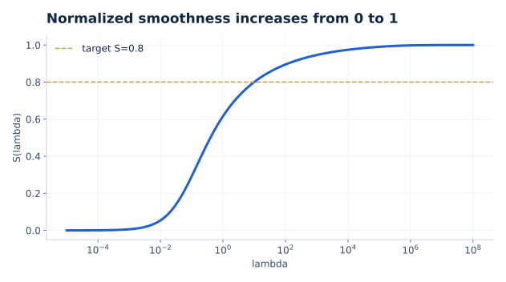

*S ranges from zero to one.*

---

<!-- _class: fig -->
# Original Guerrero smoothness versus normalized smoothness

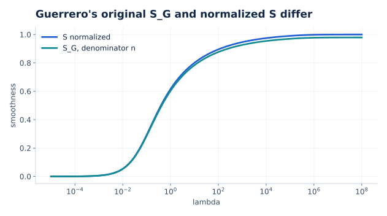

*S_G=(n-d)S/n; the distinction matters when d>0.*

---

<!-- _class: fig -->
# Different d values induce different lambda-to-S maps

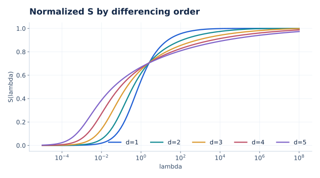

*Equal numerical penalties can yield very different shrinkage.*

---

<!-- _class: fig -->
# Equal S does not make geometries identical

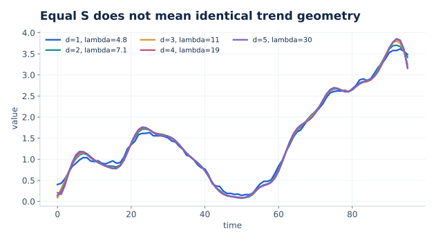

*A common trace index does not imply identical fits across orders.*

---

<!-- _class: math -->
# Prove the monotone inverse exists

For every finite $\lambda\ge0$,

$$
\boxed{
S'(\lambda)=\frac{1}{n-d}
\sum_{j=1}^{n-d}
\frac{\delta_j}{(1+\lambda\delta_j)^2}>0.}
$$

Every summand is positive on the resolved positive spectrum, so S is strictly increasing and continuous.

Define $\Lambda(s)=S^{-1}(s)$ on $0<s<1$ and extend with $\Lambda(0)=0$, $\Lambda(1)=\infty$.

---

<!-- _class: fig -->
# The first derivative remains positive

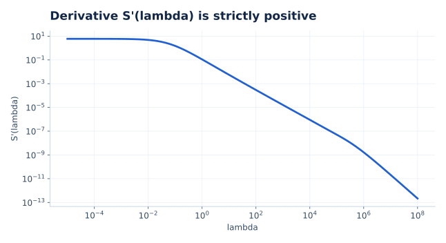

*The derivative is positive but becomes small for very large lambda.*

---

<!-- _class: fig -->
# Derivative with respect to log(lambda)

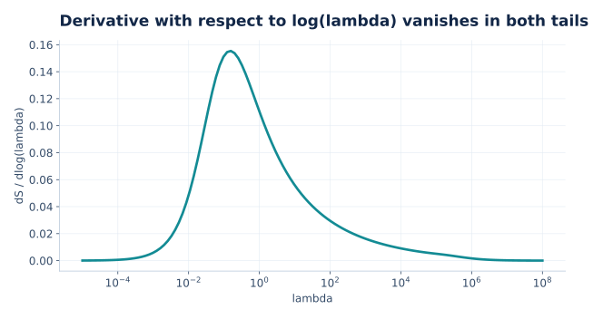

*Small slopes near both extremes matter for optimization conditioning.*

---

<!-- _class: chapter -->
# VI. Select lambda or select S

## A bounded coordinate for the same statistical problem

---

<!-- _class: math -->
# Reparameterize a criterion without changing it

Let $C(\lambda;\mu)$ denote an existing criterion evaluated at fixed $\mu$.

Write $\Lambda=S^{-1}$ and $\widetilde C(s;\mu)=C(\Lambda(s);\mu)$.

$$
\boxed{
\widehat s\in\arg\min_{s\in[0,1]}\widetilde C(s;\mu),
\quad
\widehat\lambda=\Lambda(\widehat s).
}
$$

Exact global minimizers correspond under this monotone map (ties and undefined endpoints must be treated carefully).

This is **not a newly invented selection criterion**.

---

<!-- _class: compact -->
# Two search coordinates: what changes?

| Aspect | Penalty search | Smoothness search |
| --- | --- | --- |
| Search variable | $\lambda\in[0,\infty]$ | $s\in[0,1]$ |
| Estimator | Same PLS objective | Same PLS objective |
| Criterion | Original $C(\lambda;\mu)$ | Same $C(S^{-1}(s);\mu)$ |
| Interpretation | Penalty units depend on $d$ | Fraction of penalizable EDF suppressed |
| Extra search work | No inverse of $S$ | Solve $S(\lambda)=s$ for each interior $s$ |
| Global guarantee | None from finite search | None from finite search |

**Ideal global minimizers correspond; finite grids and numerical paths need not.**

---

<!-- _class: fig -->
# Inverse smoothness: bounded S, unbounded penalty

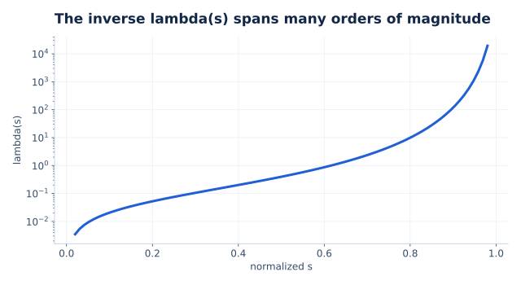

*The numerical inverse may cover many orders of magnitude.*

---

<!-- _class: fig -->
# Equal steps in S are uneven in lambda

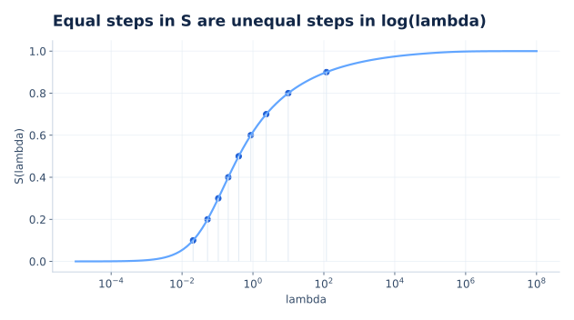

*A uniform S grid and a log-lambda grid are not the same candidate set.*

---

<!-- _class: fig -->
# The CV objective on the penalty scale

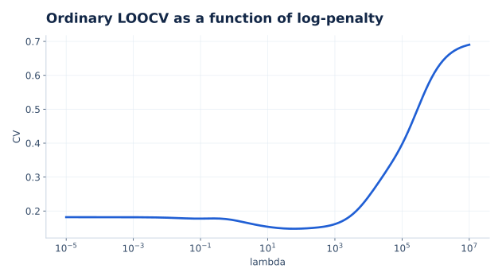

*Ordinary fixed-mu LOOCV score as a function of lambda.*

---

<!-- _class: fig -->
# The SAME CV score in the smoothness coordinate

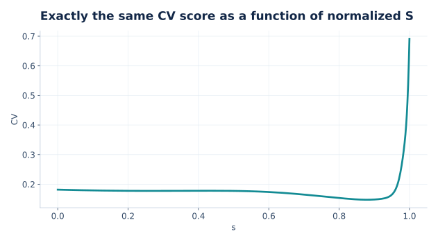

*The statistical score has not been modified.*

---

<!-- _class: fig -->
# The optimum corresponds under S and lambda

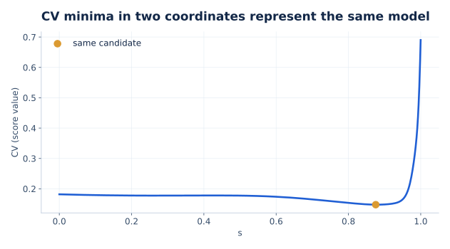

*Finite candidate grids may still find different local minima.*

---

<!-- _class: math -->
# The chain rule gives the exact derivative

Since $s=S(\lambda)$ and $S'>0$,

$$\frac{d\lambda}{ds}=\frac{1}{S'(\lambda)}.$$

Therefore,

$$
\boxed{
\frac{d\widetilde C}{ds}
=\frac{C'(\lambda)}{S'(\lambda)}
=\frac{dC/d\log\lambda}{dS/d\log\lambda}.
}
$$

Interior derivative zeros occur at the same fitted trends.  
**Near S=0 or S=1 the denominator can be tiny.**

---

<!-- _class: math -->
# The stable log-penalty derivative of S

$$
\boxed{
\frac{dS}{d\log\lambda}
=\frac{1}{n-d}
\sum_{j=1}^{n-d}
\frac{\lambda\delta_j}{(1+\lambda\delta_j)^2}>0.
}
$$

Classical CV already has an analytical derivative in the library.

For S-based CV search, evaluate the chain-rule quotient and compare multiple stationary candidates and exact boundaries.

**Neither numerical search is globally certified.**

---

<!-- _class: small -->
# What the public selector supports

| Argument | Meaning |
| --- | --- |
| search_space="lambda" | Original default, search penalties |
| search_space="smoothness" | Search normalized S in [0,1] |
| criterion="cv", method="auto" | Analytical multi-candidate derivative search |
| GCV/AICc/BIC/MLE, method="auto" | Grid search in chosen coordinate |
| Explicit grid | Interpreted in chosen coordinate |
| Result grid | Always the evaluated lambda values |
| Result search_grid | Values in requested search coordinate |

---

<!-- _class: code -->
# Try both coordinates in Python

~~~python
import numpy as np
from trendestimation import TrendSmoother, select_lambda

t = np.arange(40, dtype=float)
y = np.sin(t / 6) + np.random.default_rng(24).normal(0, .2, len(t))
solver = TrendSmoother(len(y), order=2)

default = select_lambda(
    solver, y, criterion="cv", mu=0.0, search_space="lambda",
)
bounded = select_lambda(
    solver, y, criterion="cv", mu=0.0, search_space="smoothness",
)
print("lambda search:", default.lambda_, default.smoothness)
print("S search:", bounded.lambda_, bounded.smoothness)
~~~

*Both searches return the underlying penalty and achieved smoothness.*

---

<!-- _class: small -->
# Verify equal criteria at equivalent candidates

~~~python
penalties = np.array([.1, 1.0, 10.0, np.inf])
s_grid = [solver.smoothness(x) for x in penalties]

from_lam = select_lambda(
    solver, y, criterion="gcv", mu=0.0,
    search_space="lambda", grid=penalties,
)
from_s = select_lambda(
    solver, y, criterion="gcv", mu=0.0,
    search_space="smoothness", grid=s_grid,
)

np.testing.assert_allclose(from_lam.scores, from_s.scores,
                           rtol=1e-9, atol=1e-9)
~~~

**Same mathematical scores.** Independent default grids test the
*search strategies*, not the definition of the criterion.

---

<!-- _class: code -->
# Explicit grid of normalized smoothness levels

~~~python
selected = select_lambda(
    solver, y, criterion="gcv", mu=0.0,
    search_space="smoothness",
    grid=[0, .25, .50, .75, 1],
)

selected.lambda_       # fitted penalty
selected.smoothness    # achieved normalized index
selected.grid          # evaluated penalties
selected.search_grid   # input S coordinates
selected.scores        # unchanged criterion values
~~~

---

<!-- _class: code -->
# You can also prescribe S without optimizing a criterion

~~~python
target_s = 0.80
penalty = solver.lambda_for_smoothness(target_s)

fit = solver.fit(y, lambda_=penalty, mu=0.0)
print("penalty lambda:", penalty)
print("normalized smoothness:", fit.smoothness)
print("conditional EDF:", fit.edf_conditional)
~~~

$\boxed{
S(\lambda)=0.8
\quad\Longleftrightarrow\quad
\lambda=S^{-1}(0.8).
}$

**The user chooses an interpretable smoothing level; the library finds
the penalty needed for the specified series length and order.**

---

<!-- _class: compact -->
# Why a bounded interval is not automatically faster

- Each interior S requires solving S(lambda)=s.
- Several scalar spectral evaluations can be needed per inverse.
- The chain-rule derivative can become sensitive in the tails.
- Uniform S and log-lambda grids cover **different finite candidates**.
- More optimizer evaluations can erase the advantages of an interpretable coordinate.

**No actual end-to-end runtime improvement has been established for optimizing over S.**

---

<!-- _class: chapter -->
# VII. Statistical selection criteria

## What gets minimized and how its derivative arises

---

<!-- _class: math -->
# Ordinary leave-one-out CV

Let $e=y-\widehat\tau$, $h_{ii}=(H_\lambda)_{ii}$ with **fixed numeric $\mu$**.

$$
\boxed{
\mathrm{CV}(\lambda)=
\frac1n\sum_i\left(\frac{e_i}{1-h_{ii}}\right)^2.
}
$$

At lambda=0, $H=I$ and the shortcut has zero denominators.

This is **not chronological or rolling-origin forecast validation**.

---

<!-- _class: fig -->
# The leverage of each observation

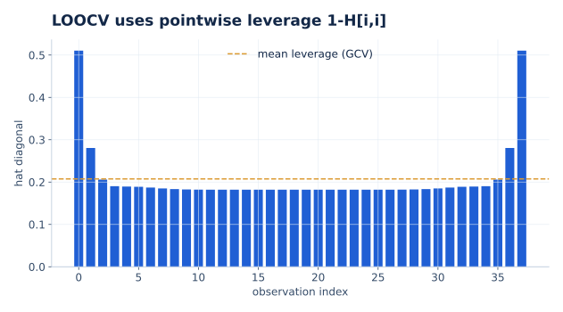

*GCV replaces individual leverages by their mean.*

---

<!-- _class: fig -->
# Training residuals vs leave-one-out residuals

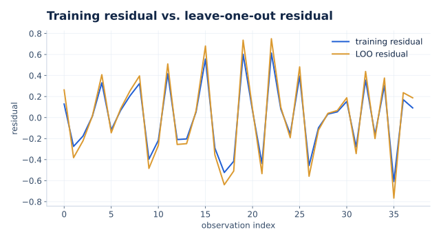

*e_i^(-i)=e_i/(1-h_ii), provided mu and the penalty are fixed.*

---

<!-- _class: math -->
# Analytical derivative of classical CV

Set $a_i=e_i$ and $b_i=1-h_{ii}$. From $H'=-HQH$,

$$a'=HQH(y-p),\qquad b_i'=(HQH)_{ii}.$$

Then

$$
\boxed{
\mathrm{CV}'(\lambda)=\frac2n
\sum_i \frac{a_i}{b_i}
\frac{a_i'b_i-a_ib_i'}{b_i^2}.
}
$$

**This is an analytical derivative, not a closed-form optimal lambda.**

---

<!-- _class: math -->
# GCV, AICc, BIC: implemented conventions

With $R=\mathrm{RSS}$ and $\nu=\operatorname{tr}(H_\lambda)$:

$$
\boxed{\mathrm{GCV}=\frac{R/n}{(1-\nu/n)^2}.}
$$

$$
\boxed{\mathrm{AICc}=\log(R/n)+\frac{2\nu+1}{n-\nu-2}.}
$$

$$
\boxed{\mathrm{BIC}=\log(R/n)+\frac{\nu\log n}{n}.}
$$

Admissible domains matter; AICc conventions vary across the literature.

---

<!-- _class: fig -->
# All four scores as functions of lambda

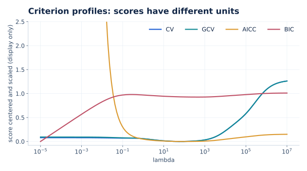

*Profiles centered and rescaled only for the plot. Real selection uses original units.*

---

<!-- _class: fig -->
# Different criteria yield different in-sample trends

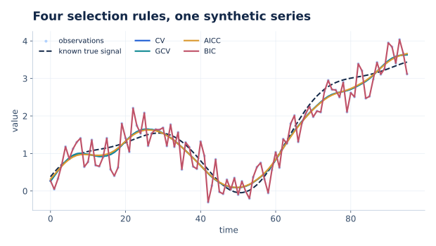

*A single seeded example does not establish an overall ranking.*

---

<!-- _class: fig -->
# LOOCV versus chronological holdout

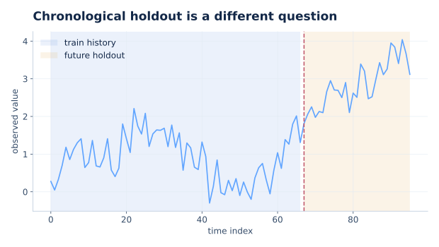

*Future-horizon forecasting requires a different experimental design.*

---

<!-- _class: chapter -->
# VIII. Gaussian marginal likelihood

## Conditional MLE is implemented; joint mu profiling is future work

---

<!-- _class: math -->
# The Gaussian stochastic model

$$
y=\tau+\varepsilon,\qquad
\varepsilon\sim N(0,\sigma_\varepsilon^2 I).
$$

$$
D_d\tau-\mu\mathbf1\sim N(0,\sigma_\eta^2 I),
\qquad
\boxed{\lambda=\frac{\sigma_\varepsilon^2}{\sigma_\eta^2}.}
$$

This is a **model-based interpretation**, not a property of arbitrary distributions.

The unpenalized polynomial coordinates are treated as nuisance trend components.

---

<!-- _class: math -->
# Conditional Gaussian marginal likelihood

Set $r=n-d$, $w_j(\lambda)=\lambda\delta_j/(1+\lambda\delta_j)$ and $z_j=v_j^\top(y-p_\mu)$.

The profile score, up to constants, is

$$
\boxed{
L(\lambda;\mu)=
r\log\left(\frac1r\sum_{j=1}^r w_jz_j^2\right)
-\sum_{j=1}^r\log w_j.
}
$$

It profiles observation variance and selects $\lambda$ for fixed or plug-in $\mu$.

---

<!-- _class: fig -->
# Conditional marginal-likelihood score

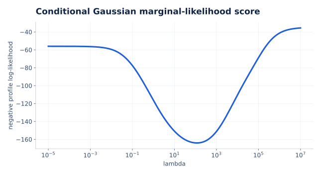

*Gaussian model-based score, not cross-validation.*

---

<!-- _class: math -->
# The analytical conditional likelihood mean

Let $p_t^{(1)}=\binom td$, $z_j=v_j^\top y$ and $b_j=v_j^\top p^{(1)}$.

For fixed positive $\lambda$,

$$
\boxed{
\widehat\mu(\lambda)=
\frac{\sum_jw_j(\lambda)b_jz_j}
{\sum_jw_j(\lambda)b_j^2}.
}
$$

A nonzero denominator follows from the positive-subspace model assumptions.

**This formula is retained as a deferred research result, not a validated joint API.**

---

<!-- _class: fig -->
# The optimal conditional mean can depend on lambda

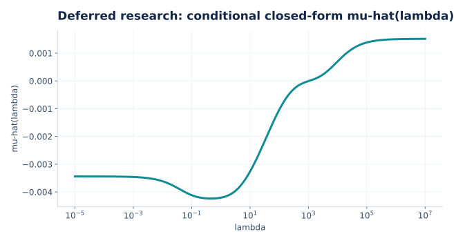

*Derived profile formula; no joint numerical optimizer is claimed.*

---

<!-- _class: math -->
# A future scalar optimization of both lambda and mu

Rather than optimizing two variables numerically, insert the conditional optimum into the likelihood:

$$
\boxed{
\widehat\lambda=
\arg\min_{\lambda>0}J(\lambda;\widehat\mu(\lambda)).
}
$$

**Open problems:** identifiability, boundary optima, numerical stability, inference and a fair comparison against conditional MLE.

This extension is not yet experimentally validated in the library.

---

<!-- _class: fig -->
# Visualize the analytical joint-likelihood surface

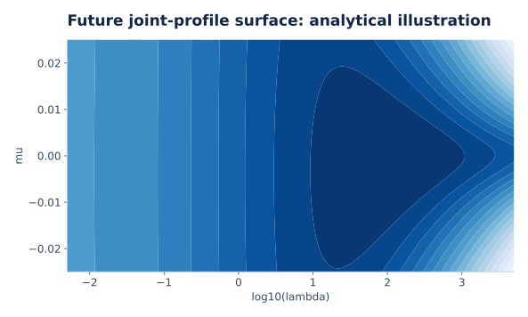

*Analytical schematic based on derived formula, not a released joint estimator.*

---

<!-- _class: math -->
# Joint profiling could also use bounded S

With $\Lambda(s)=S^{-1}(s)$,

$$
\boxed{
\widehat s_{\mathrm{joint}}=
\arg\min_{0<s<1}
J\big(\Lambda(s);\widehat\mu(\Lambda(s))\big).
}
$$

Then $\widehat\lambda_{\mathrm{joint}}=\Lambda(\widehat s_{\mathrm{joint}})$.

This **changes coordinates only**; the joint estimation problem still requires implementation and validation.

---

<!-- _class: compact -->
# What is currently implemented versus future

| Functionality | Research status |
| --- | --- |
| Fixed mu PLS fitting | Implemented |
| Observed-difference mu plug-in | Implemented |
| Conditional Gaussian MLE | Implemented |
| Conditional MLE search in S | Implemented |
| Analytical $\widehat\mu(\lambda)$ | Mathematical derivation |
| Joint $(\lambda,\mu)$ solver | Not yet implemented |
| Confidence intervals for joint estimates | Not yet validated |

---

<!-- _class: chapter -->
# IX. Numerical inversion algorithms

## Root finding is not the same as optimizing a criterion

---

<!-- _class: math -->
# Invert normalized smoothness numerically

For a prescribed $s\in(0,1)$, solve

$$F(\lambda)=S(\lambda)-s=0.$$

For $x=\log\lambda$, evaluate stable logistic spectral terms:

$$
S(e^x)=\frac1{n-d}\sum_j
\frac{1}{1+\exp[-(x+\log\delta_j)]}.
$$

Methods in the library: **Brent, safeguarded Newton, safeguarded secant and bisection**, plus exact special-spectrum inversion.

Endpoints $s=0,1$ require no root search.

---

<!-- _class: fig -->
# Compare safeguarded root-solving ideas

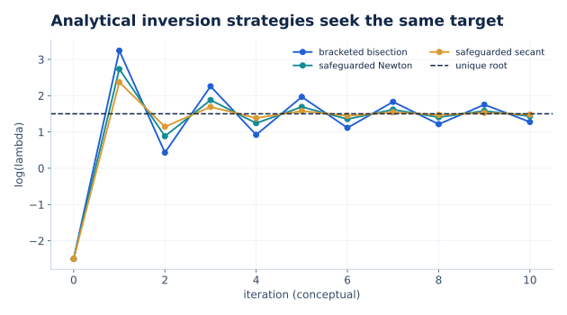

*Illustrative solver trajectories, not actual recorded iteration histories.*

---

<!-- _class: compact -->
# Two mathematically distinct numerical tasks

**A. Invert smoothness**

$$S(\lambda)-s=0$$

has one root because $S'>0$.

**B. Select a statistical criterion**

$$C'(\lambda)=0$$

can have multiple stationary points and non-global minima.

**A derivative root is not automatically the global minimum.**

---

<!-- _class: compact -->
# The actual library selection pipeline

1. Fix n, difference order d, and mean convention.
2. Precompute spectral information.
3. Choose CV / GCV / AICc / BIC / conditional MLE.
4. Choose search_space=lambda or search_space=smoothness.
5. Evaluate sampled candidates (invert S first when needed).
6. For CV, inspect analytical derivative sign changes and local valleys.
7. Compare the **original score** at admissible candidates and endpoints.
8. Return selected lambda, selected S and aligned search metadata.

A finite multi-start search cannot *prove* a global minimum.

---

<!-- _class: chapter -->
# X. Why is spectral computation potentially fast?

## Compare identical workloads and honest baselines

---

<!-- _class: compact -->
# Four independent implementations

| Solver family | What is included |
| --- | --- |
| Dense fresh | Rebuild D and Q, then solve per candidate |
| Dense cached | Build Q once, solve dense system repeatedly |
| Spectral SVD | Build full SVD once, reuse basis and weights |
| Direct banded | Build narrow band storage and use a structured solve |

The **banded baseline matters**: beating a deliberately naive dense solver alone is insufficient.

---

<!-- _class: fig -->
# Operation-count growth is not measured elapsed time

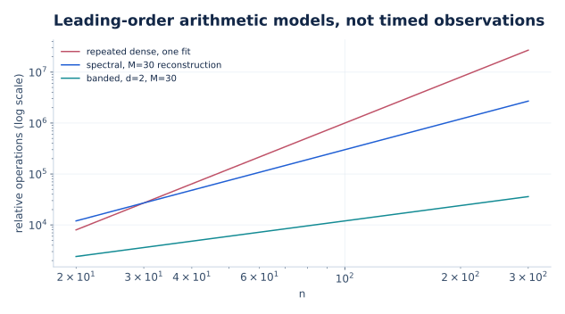

*Analytical complexity models with schematic proportionality constants.*

---

<!-- _class: math -->
# Leading work for M reconstructed trends

| Method | Leading cost |
| --- | --- |
| Repeated dense solving | $O(Mn^3)$ |
| One SVD plus M reconstructions | $O(n^3)+O(Mn^2)$ |
| Banded solving at fixed d | About $O(Mnd^2)$ plus setup |
| Spectral trace-only queries | $O(n^3)+O(Mn)$ |

**Setup, memory and actual machine effects must be included in timings.**

---

<!-- _class: fig -->
# The number of candidate penalties changes the crossover

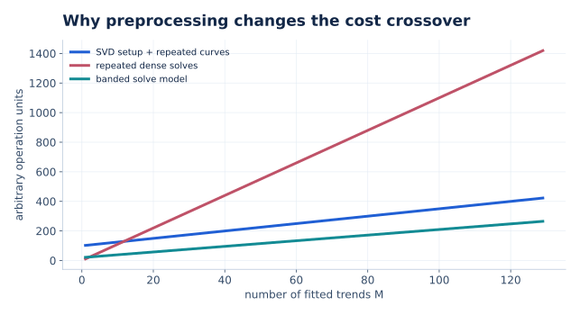

*Conceptual cost model only; no invented runtime measurements.*

---

<!-- _class: fig -->
# Real host timings: full fitted-curve workload

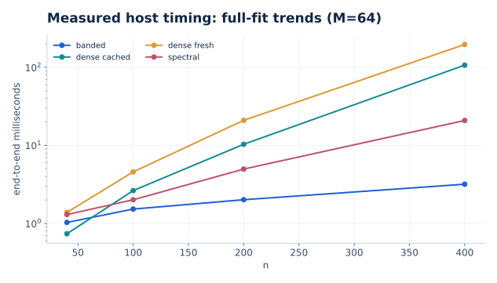

*Loads genuine host CSV when available; otherwise reports missing measurements explicitly.*

---

<!-- _class: fig -->
# Real host timings: EDF trace-only workload

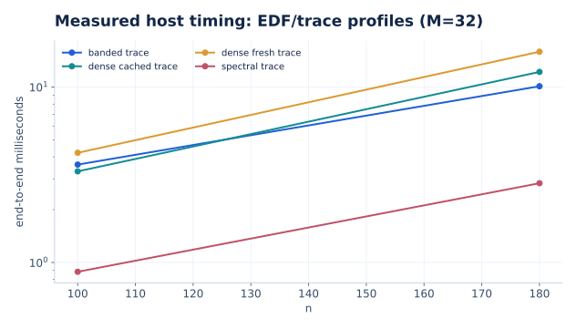

*A scalar trace is not the same workload as reconstructing M fitted curves.*

---

<!-- _class: compact -->
# What it would take to claim that a method is faster

- Measure **complete end-to-end time**, including setup and M evaluations.
- Match n, d, mu, lambda candidates and numerical precision.
- Save source revision, CPU/BLAS/software versions and thread count.
- Repeat runs; report medians and dispersion.
- Record a numerical agreement tolerance against independent solvers.
- A ratio greater than one demonstrates only a **host- and workload-specific** advantage.
- Searching in S adds scalar inversion overhead not measured by the original four-solver benchmark.

**No GPU or energy savings have been demonstrated.**

---

<!-- _class: chapter -->
# X-B. The full solver × criterion × coordinate experiment

## Which pipeline is actually faster, and when does the answer change?

---

<!-- _class: compact -->
# The proposed Computational Statistics experiment

**Question:** Should we optimize a classical criterion directly in the penalty, or in the normalized smoothness index?

We cross:

- **3 backends:** singular-value decomposition (SVD), eigen-decomposition of $Q_d=D_d^\top D_d$, and direct *banded Cholesky*.
- **4 statistical criteria:** CV, GCV, AICc and BIC.
- **3 candidate-coordinate strategies:** direct $\lambda$ search, mapped-$S$ search, native uniform-$S$ search.

That is **36 measured configurations per $(n,d,\mu,y)$ and timing block**.

All three backends solve the *same* finite-difference PLS problem. The statistical criteria are not redefined.

---

<!-- _class: math -->
# Two ways to get the same exact optimum

Assume the same admissible search domain and exact global minimization:

$
\widehat\lambda=\arg\min_{\lambda\geq 0} C(\lambda;\mu),
\qquad
\widehat s=S(\widehat\lambda).
$

Equivalently,

$
\widehat s=\arg\min_{0\le s\le1}C(S^{-1}(s);\mu),
\qquad
\widehat\lambda=S^{-1}(\widehat s).
$

**The two ideal minima correspond.** But actual grids, solvers, rounding, boundary treatment and computation time can differ.

---

<!-- _class: compact -->
# Three strategies, not merely two labels

| Strategy | Candidate construction | Post-search operation |
| --- | --- | --- |
| **Direct $\lambda$** | Prescribed geometric $\lambda$ grid | Compute $S(\widehat\lambda)$ **once** |
| **Mapped $S$** | Apply $S$ to the *same* $\lambda$ grid | Invert $S$ once **per candidate** |
| **Native $S$** | Sample uniformly in $S\in(0,1)$ | Invert $S$ once **per candidate** |

The **mapped** comparison isolates coordinate-conversion overhead and should select the same candidate within numerical error.

The **native** comparison changes the grid; it evaluates whether uniform spacing in interpretable smoothing degrees is valuable enough to justify inversion.

---

<!-- _class: math -->
# What extra computation does the S-first route require?

The inverse mapping solves a scalar root problem:

$
F(x;s)=S(e^x)-s=0,\qquad x=\log\lambda.
$

For $r=n-d$ penalized spectral modes:

$
S(e^x)=\frac1r\sum_{j=1}^{r}
\frac1{1+\exp[-(x+\log\delta_j)]}.
$

If each inverse takes $K$ scalar trace evaluations, a grid of $M$ smoothness targets requires approximately $KM$ additional trace evaluations.

**Direct $\lambda$ search requires only one final $\lambda\to S$ conversion.**

---

<!-- _class: fig -->
# CV: the identical objective in both coordinates

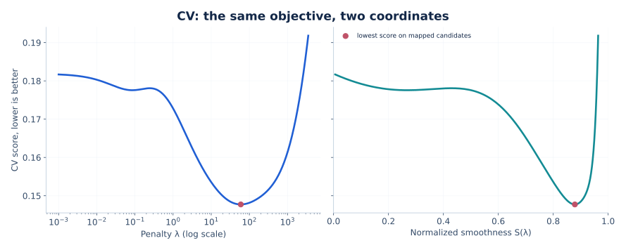

*Both panels plot precisely the same candidate penalties; minimum and score must correspond.*

---

<!-- _class: fig -->
# GCV: changing coordinates does not alter its definition

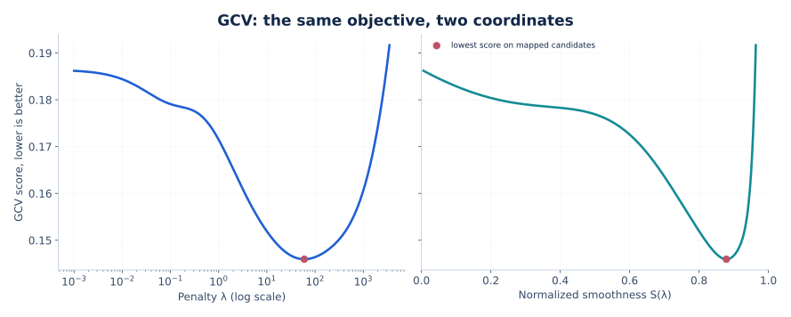

*Smoothness replaces the horizontal coordinate, not the GCV loss.*

---

<!-- _class: fig -->
# AICc: the same selected score under a mapped grid

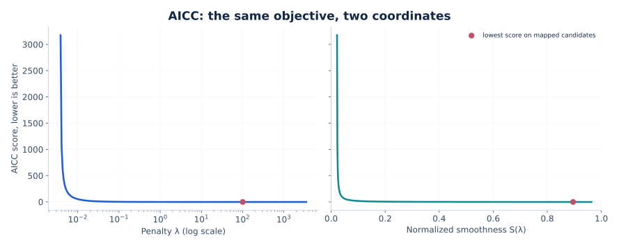

*These panels illustrate the numerical equivalence of one finite candidate set.*

---

<!-- _class: fig -->
# BIC: inspect near-interpolation and boundary behavior

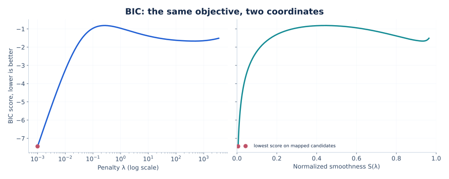

*The finite-grid minimizer need not be a robust interior statistical optimum.*

---

<!-- _class: compact -->
# The 36-case experimental matrix

For *each* statistical criterion:

| Backend | Direct $\lambda$ | Mapped $S$ | Native $S$ |
| --- | :---: | :---: | :---: |
| SVD of $D_d$ | CV/GCV/AICc/BIC | CV/GCV/AICc/BIC | CV/GCV/AICc/BIC |
| $\operatorname{eigh}(D_d^\top D_d)$ | CV/GCV/AICc/BIC | CV/GCV/AICc/BIC | CV/GCV/AICc/BIC |
| Banded Cholesky | CV/GCV/AICc/BIC | CV/GCV/AICc/BIC | CV/GCV/AICc/BIC |

**Repeat across** $n$, difference order $d$, fixed $\mu$, simulated series, random seeds, and timing blocks.

This is a **finite-grid** factorial search study, not yet the analytical-gradient optimizer benchmark.

---

<!-- _class: math -->
# A single normal-equation matrix, three factorizations

$
Q_d=D_d^\top D_d,\qquad
A_\lambda=I+\lambda Q_d,\qquad
A_\lambda \widehat x=y-p_\mu.
$

**SVD:** $D_d=U\Sigma V^\top$ gives reusable singular vectors.

**Diagonalization:** $Q_d=V\Delta V^\top$ gives reusable eigenvectors, but explicitly forming $Q_d$ can square conditioning.

**Cholesky:** $A_\lambda=L_\lambda L_\lambda^\top$ exploits bandwidth $d$, but the factor depends on $\lambda$.

Numerical methods differ; **the statistical estimator is unchanged.**

---

<!-- _class: compact -->
# Workload is criterion-dependent

| Criterion | Needs fitted residual energy? | Needs $\operatorname{tr}(H)$? | Needs $h_{ii}$? |
| --- | :---: | :---: | :---: |
| Classical **CV** | Yes (pointwise) | Not necessarily | **Yes** |
| **GCV** | Yes (scalar RSS) | **Yes** | No |
| **AICc** | Yes (scalar RSS) | **Yes** | No |
| **BIC** | Yes (scalar RSS) | **Yes** | No |
| Smoothness inversion | No observed-data residual | **Yes, repeatedly** | No |

Computing a single trend quickly is **not** the same as computing its CV score quickly.

---

<!-- _class: math -->
# Why Cholesky needs extra work for CV or S

For finite $\lambda\ge 0$, $A_\lambda$ is positive definite because

$
x^\top A_\lambda x=\|x\|^2+\lambda\|D_dx\|^2>0.
$

Banded Cholesky can solve $A_\lambda x=b$ efficiently for one right-hand side.

But obtaining the *exact* trace and leverage diagonal through this implementation requires

$
H_\lambda=A_\lambda^{-1},\quad
\nu=\operatorname{tr}(H_\lambda),\quad
h_{ii}=(H_\lambda)_{ii}.
$

The factorial script obtains these from **$n$ right-hand-side solves**, timed inside the Cholesky workload.

---

<!-- _class: compact -->
# An honest SVD versus Cholesky comparison

**SVD/eigh:** pay a larger one-time spectral setup; reuse the diagonal attenuation for new penalties.

**Cholesky:** comparatively inexpensive banded preparation and factorization for one $\lambda$; however, CV leverage, EDF and $S^{-1}$ require additional operations.

Our experiment does **not** borrow the SVD eigenvalues when labeling a cell "Cholesky in S": it recomputes the required trace from Cholesky solves.

**Important:** `scipy.linalg.solve_banded` in the older paper benchmark is *not* a measured Cholesky-specific timing. The new factorial study uses `cholesky_banded` and `cho_solve_banded` explicitly.

---

<!-- _class: compact -->
# Original sources: what is already known?

- **Cortés-Toto, Guerrero and Reyes (2017):** compare PLS criterion selection and resulting trend smoothness; they cite Weinert's Cholesky-based spline algorithms, but do *not establish* that Cholesky was their own simulation backend.
- **Weinert (2007):** efficient Whittaker–Henderson smoothing.
- **Weinert (2012), _Fast Compact Algorithms and Software for Spline Smoothing_:** numerical algorithms including Cholesky, QR and FFT.

**Our research question differs:** cross **numerical backend × statistical criterion × search coordinate** for discrete difference-penalized trends, with end-to-end time and numerical agreement.

Novelty requires an informed literature review; a Cartesian-product experiment is not automatically a theoretical advance.

---

<!-- _class: compact -->
# A benchmark must decompose its elapsed time

For every cell, record:

1. **Setup** — finite-difference/band construction, SVD/eigh if applicable.
2. **Coordinate inversion** — all root iterations for interior smoothness candidates.
3. **Criterion evaluation** — complete CV/GCV/AICc/BIC scores for all candidates.
4. **Post-map** — map the selected penalty back to normalized $S$.
5. **End-to-end time** — measured from before setup through reporting the optimum.

The script also records objective calls, number of inversions and number of trace evaluations, *and* the selected $\widehat\lambda,\widehat s,C(\widehat\lambda)$.

---

<!-- _class: fig -->
# Observed experiment: 36 cells per workload

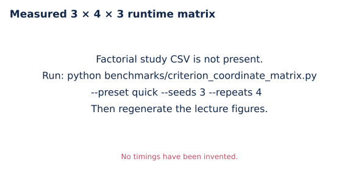

*Measured medians only. If the new benchmark is absent, this panel explains the missing evidence.*

---

<!-- _class: fig -->
# Is searching in S faster than searching in lambda?

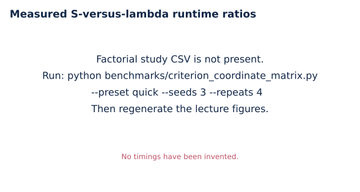

*Ratio above 1 means native S search was slower **on the tested machine**. No universal ranking follows.*

---

<!-- _class: fig -->
# Where was the time spent?


*Measured phases separate factorization setup, inverse calculation, scoring and final conversion.*

---

<!-- _class: fig -->
# Did a faster search choose a worse candidate?


*Mapped-S scores should agree with direct lambda scores. Native S searches a different candidate grid.*

---

<!-- _class: compact -->
# Compare both quality and speed

**Runtime alone is insufficient.** A candidate search returning a different penalty can be faster but statistically worse *under its own criterion*.

Evaluate both:

$
T_{\text{end-to-end}}\quad\text{and}\quad
\Delta C=C(\widehat\lambda_{\mathrm{alternative}})
-C(\widehat\lambda_{\lambda\text{-grid}}).
$

For mapped grids, $\Delta C$ should be approximately zero, allowing for inversion and floating-point discrepancies.

For native uniform-S grids, $\Delta C$ can be positive or negative because **different candidate sets** are compared.

---

<!-- _class: compact -->
# A crucial limitation: grid search versus auto optimization

Our initial 36-case factorial uses **equal numbers of candidate points** for its three coordinate strategies.

The released `select_lambda` API behaves differently by default:

- For CV, it uses derivative-based refinement and a multi-start scan.
- For GCV/AICc/BIC, it uses prescribed grids unless the caller overrides.
- CV in S uses a uniform *and* logit-spaced mesh, not just the direct-$\lambda$ mesh.

**Therefore:** the factorial study does *not* measure the complete default public auto-selector. That requires a second, separately labelled API benchmark.

---

<!-- _class: compact -->
# Reproducible runs from the repository root

```bash
python -m pip install -e ".[plot]" threadpoolctl
python benchmarks/criterion_coordinate_matrix.py \
  --preset smoke --seeds 1 --repeats 2

python benchmarks/criterion_coordinate_matrix.py \
  --preset quick --seeds 3 --repeats 4 --threads 1

python slides/professor_lecture/make_figures.py
bash slides/professor_lecture/build.sh --html-only
```

Produces `build/criterion-coordinate-study/raw_trials.csv`, `summary.csv`, `environment.json` and SVG timing figures.

**Publication-grade inference** should use more independent seeds, timing blocks, a controlled host, and paired analysis.

---

<!-- _class: chapter -->
# X-C. What does the public selector actually do?

## From a controlled grid experiment to the released optimization algorithms

---

<!-- _class: compact -->
# Benchmark the actual library method='auto'

The factorial matrix is controlled: same number of candidate points for the three strategies.

Now run the **actual** public code:

```python
select_lambda(model, y, criterion="cv",
              search_space="lambda", method="auto")
select_lambda(model, y, criterion="cv",
              search_space="smoothness", method="auto")
```

Repeat with GCV, AICc, BIC; record **full construction + selection time**, evaluated candidate count, chosen penalty and criterion score.

The CV default uses **different** multi-start candidate grids and derivative refinement in the two coordinates. These are *not* a matched-budget comparison.

---

<!-- _class: fig -->
# Public API: direct penalty versus inverse-smoothness search


*Only recorded host times appear. The reported total includes construction of the public TrendSmoother.*

---

<!-- _class: fig -->
# Public API: did each strategy do the same work?


*We must report objective-candidate counts as well as the scores reached, especially for derivative-based CV.*

---

<!-- _class: compact -->
# Run the two complementary studies

```bash
# Controlled factorial: 3 solvers × 4 criteria × 3 searches
python benchmarks/criterion_coordinate_matrix.py \
  --preset quick --seeds 3 --repeats 4 --threads 1

# Released API: 4 criteria × 2 auto search coordinates
python benchmarks/public_coordinate_optimizer_benchmark.py \
  --preset quick --seeds 3 --repeats 4 --threads 1

# Generate charts with actual CSVs and export presentation
bash slides/professor_lecture/build.sh --html-only
```

**Do not combine the two runtime studies into a single speed ranking:** their candidate policies and workloads differ.

---

<!-- _class: compact -->
# What should we test next for the journal?

**Three increasingly strong experiments:**

1. **Exact same $\lambda$ candidates:** numerical and speed parity, including inversion overhead.
2. **Same candidate budget, different coordinate grids:** runtime *and* quality of selected score; vary $n$, $d$ and noise.
3. **Actual optimizer strategies:** derivative roots, multistart scalar minimization, inversion root solvers, and the public API's native CV refinements.

Then test other structured families where appropriate: Whittaker–Henderson and cubic smoothing splines, without conflating their function spaces, penalties or boundary conditions.

---

<!-- _class: chapter -->
# X-D. Completed Windows full-factorial study

## From one computation to 17 smoothness targets, eight repeated searches and continuous optimization

---

<!-- _class: compact -->
# 80,640 actual measurements — not simulations of runtime

The author ran the **full** workload on Windows (Python 3.11, one BLAS thread, seven repetitions).

- $n=24,48$; difference orders $d=0,1,2,3,4,5$.
- Fixed reference-difference mean $\mu=0$ versus $\mu=0.15$.
- Seven backends: fresh/cached dense, general banded, dense/banded Cholesky, eigendecomposition and SVD.
- Five criteria: CV, GCV, AICc, BIC, conditional Gaussian MLE (**not applicable for $d=0$**).
- $R=1,3,8$ independent series; cold versus shared preparation.
- Two recorded seeds (20261026, 20261027).

**Source:** `paper/benchmarks/results/full_s_search_modes/` and its Windows environment.json.

---

<!-- _class: math -->
# All seventeen normalized-S targets, including both boundaries

$
\mathcal G_S=\{0,0.1,\ldots,0.9,1\}
\cup\{0.95,0.99,0.999,0.9999,0.999999,0.999999999999\}.
$

**15 finite interior** values + two exact limits.

- $S=0\implies\lambda=0$: interpolating fit; ordinary CV/GCV undefined at this endpoint.
- **$S=1\implies\lambda=\infty$**, not a large finite factorization.
- At $d\ge1$, the limit is the polynomial-nullspace projection adjusted for fixed $\mu$.
- At $d=0$, the limiting trend is the constant $\mu\mathbf1$.

The exact endpoint is evaluated **analytically**; no method factors $I+\infty Q$.

---

<!-- _class: fig -->
# One score, a full grid, then eight full searches


*Real Windows GCV measurements; $n=48,d=1,\mu=0$. Only numerically valid method/workload cells appear; one-time inversion is counted in standalone mapping.*

---

<!-- _class: compact -->
# Same grid or different grid? Three computational policies

| Policy | Candidate penalties | Cost of transforming S |
|:--|:--|:--|
| Native $S$ | Prescribed 17-point S grid | Invert every scored target |
| Premapped $S\to\lambda$ | **Exactly the same** 17 penalties | Invert once, reuse |
| Direct log-$\lambda$ | **Different interior** points, same bounds and count | No inverse S needed |

**The first two must select the same criterion score and smoothness.**

A faster log-$\lambda$ grid is *not* evidence of better selection at identical candidate penalties.

---

<!-- _class: fig -->
# Windows selection times for all five criteria


*Full 17-target search, $n=48,d=2,R=1,\mu=0$, spectral SVD; time in milliseconds. Premapped standalone time charges one inverse-grid conversion.*

---

<!-- _class: compact -->
# One full grid: actual paired Windows timings

*Median across two seeds; $n=48,d=2,\mu=0,R=1$, SVD.*

| Criterion | Native $S$ | Map $S\to\lambda$ once | Direct log-$\lambda$* |
|:--|--:|--:|--:|
| CV | 2.004 ms | 1.879 ms | 0.545 ms |
| GCV | 1.851 ms | 1.800 ms | 0.426 ms |
| AICc | 1.887 ms | 1.810 ms | 0.458 ms |
| BIC | 2.016 ms | 1.810 ms | 0.449 ms |
| MLE | 3.477 ms | 2.035 ms | 0.515 ms |

*The direct log-penalty grid evaluates **different interior targets**.*

**4,484 valid matched-coordinate seed pairs:** zero difference in recorded selected $S$ and scores.

---

<!-- _class: math -->
# Why the mapping pays off when reused

For $M$ fixed targets and $K$ selections, to first order:

$
T_{\text{native }S}\approx KM(t_{\rm inv}+t_{\rm score}),
\qquad
T_{\text{mapped}}\approx Mt_{\rm inv}+KMt_{\rm score}.
$

$
\boxed{\text{Avoided repeated inversion}\approx(K-1)Mt_{\rm inv}.}
$

**Measured Windows run: five criteria sharing one grid, $n=48,d=2,\mu=0$:**

**11.234 ms** native-$S$ selections vs **3.980 ms** one translation plus five searches.

Descriptive speed ratio: **2.82×**, not a universal hardware-independent result.

---

<!-- _class: fig -->
# Repeated searches: cold versus shared preparation


*Eight independent series, $n=48,\mu=0$, SVD, by difference order and criterion. Ratios are backend-only; missing cases were not fully validated.*

---

<!-- _class: compact -->
# Continuous optimization is NOT the 17-point grid

We also evaluate the same criterion in two different continuous coordinates:

$
\min_{0<s<1}C(S^{-1}(s))
\qquad\text{versus}\qquad
\min_{x\in\mathbb R}C(e^x),\quad x=\log\lambda.
$

The implemented scalar searches are **bounded local optimizers**, with exact endpoints checked analytically.

Their evaluation counts and candidate positions differ. They may converge to **different local minima**.

That is not evidence of a different statistical criterion or guaranteed global optimality.

---

<!-- _class: fig -->
# Bounded local optimization: S versus log(lambda)


*Actual Windows timings, SVD, $n=48,d=2,\mu=0$. These are local numerical searches, not certified global minima.*

---

<!-- _class: fig -->
# The effect of a nonzero fixed reference mean


*Median selected $S$ across two seeds; $n=48,d=2$. A median like 0.85 may lie BETWEEN sampled grid points. $\mu$ is fixed, not jointly estimated.*

---

<!-- _class: compact -->
# The near-one numerical stability boundary matters

The target $S=0.999999999999$ can require a huge finite penalty, especially for high $d$.

- Dense, banded and Cholesky numerical evaluations may lose agreement in float64 near the limit.
- A solver with inaccurate or missing candidate scores cannot claim a complete-grid timing victory.
- A mathematically undefined criterion is **not** the same thing as a failed matrix factorization.
- Exact $S=1$ is an analytical limiting case, never a numerical LU/Cholesky solve.

**Backend policy must depend on both workload and numerical correctness.**

---

<!-- _class: compact -->
# Everything used here is archived in GitHub

**Original Windows experiment:** `paper/benchmarks/results/full_s_search_modes/` — 80,640 rows and environment metadata.

**Derived two-seed study:** `paper/benchmarks/windows_full_s_analysis/` — 40,320 paired design cells, candidate parity, selection outcomes and timings.

**Paper and publication figures:** `paper/main.pdf`, `paper/sections/windows_full_s_results.tex`, and five AwesomeFigures PDF/SVG pairs in `paper/figures/`.

**Website:** `docs/windows_full_s_results.rst`

All five slides reuse the **exact publication SVG files**, with source SHA-256 hashes recorded in the slide manifest. No 80,640-cell rerun is needed.

---

<!-- _class: code -->
# Rebuild both artifacts locally and commit the results

```powershell
conda activate trendestimation
python -m pip install -e ".[dev,docs,plot]"
python -m pip install -r paper/requirements.txt

# Regenerate paper tables and figures from archived data:
python paper/benchmarks/report_windows_full_s.py
python paper/build.py --figures --pdf --package

# Regenerate lecture figures and Marp PDF/HTML:
powershell -ExecutionPolicy Bypass -File slides/professor_lecture/build.ps1
```

**PDF prerequisites:** MiKTeX or TeX Live plus latexmk (paper); Node.js and Chromium/Chrome (Marp). Both PDFs can be force-added to Git.

---

<!-- _class: chapter -->
# XI. Numerical stability

## Arbitrary admissible d does not imply stable floating-point computation

---

<!-- _class: fig -->
# Penalty energy shrinks with increasing lambda


*Computed with the original order-two difference operator.*

---

<!-- _class: fig -->
# Positive-spectrum conditioning grows with d


*Computed from the singular values of D_d on a deterministic n=50 case.*

---

<!-- _class: math -->
# The exact condition-ratio definition

The penalty Q is singular when $d\ge1$. Instead inspect only its strictly positive spectrum:

$$
\boxed{
\kappa_+(Q_d)=
\frac{\max_{1\le j\le n-d}\delta_j}
{\min_{1\le j\le n-d}\delta_j}.
}
$$

In the manuscript's higher-order diagnostic (n=50, d=1..10), this increases to approximately $2.44\times10^{15}$ at d=10.

**This is not the condition number of $I+\lambda Q_d$.**

---

<!-- _class: fig -->
# Spectral and normal-equation fits can diverge numerically


*Both are float64 numerical methods; direct normal equations are not exact ground truth at high d.*

---

<!-- _class: compact -->
# Deterministic agreement checks in the paper

Paper-specific script, n=50, lambda=30, seed 20261021, and

$$d\in\{1,2,3\},\quad \mu\in\{0,0.15\}.$$

Reported maximum fitted-ordinate difference against direct normal equations: approximately $2.01\times10^{-12}$.

Reported infinite-penalty difference constraint error: approximately $4.42\times10^{-12}$.

These are results for **the stated inputs**, not a general forward-error theorem.

---

<!-- _class: compact -->
# What the new S-coordinate tests actually test

- Matched candidate penalties and normalized-S grids for d=0,1,2,4.
- Nonzero fixed mean and all classical scores.
- Analytical CV gradient in S against numerical finite differences.
- Exact endpoints, invalid coordinates and float64 extremes.
- The d=0 degeneracy: CV and GCV may tie across positive penalties.

**No comparative optimization runtime was measured by those tests.**

---

<!-- _class: fig -->
# Residuals still need their own diagnostics


*Smoothing does not itself imply independent or Gaussian residuals.*

---

<!-- _class: chapter -->
# XII. Applications and interpretation

## Illustrative synthetic truth and historical atmospheric data

---

<!-- _class: compact -->
# The nonlinear synthetic scenario in the paper

A Cortés-Toto-inspired single realization:

$$
\tau(t)=0.6f_{\mathrm{Beta}(30,17)}(t/n)
+0.4f_{\mathrm{Beta}(3,11)}(t/n).
$$

- n=50, Gaussian observation-noise SD=0.5, seed=19.
- No seasonality for this declared replication.
- d=2, fixed mu=0.
- CV/GCV/AICc/BIC on the same 121-point geometric lambda grid plus infinity.
- RMSE versus known synthetic truth is **trend recovery**, not forecast accuracy.

---

<!-- _class: fig -->
# Criteria versus known synthetic truth


*Visualized curves are deterministic; one case does not rank methods in general.*

---

<!-- _class: fig -->
# Real observations: Mauna Loa CO2, 1990–1999


*Monthly averages of statsmodels weekly CO2 observations, when the optional dataset is installed.*

---

<!-- _class: compact -->
# The observational illustration uses common normalized S

The paper sets

$$\boxed{S=0.86,\qquad\mu=0}$$

and compares d=2,3,4,5 on 120 monthly values.

Reported penalty values: approximately 37.03, 134.01, 488.32 and 1702.30.

Seasonality in CO2 is physical structure, not automatically measurement noise. The fitted curves are **two-sided historical trends** and are not evaluated as forecasts.

---

<!-- _class: chapter -->
# XIII. What is new, exactly?

## Existing theory, released software, numerical validation and future research

---

<!-- _class: compact -->
# What must not be presented as a mathematical invention

- Finite-difference penalized least squares.
- Arbitrary positive integer difference order.
- Nonzero difference-reference means.
- Polynomial nullspaces and eigenvalue attenuation.
- Existing trace-based smoothness concepts.
- CV, GCV, AICc, BIC and Gaussian likelihood as classes of methods.

**Accurate attribution makes a computational contribution more credible.**

---

<!-- _class: compact -->
# What this library integrates

- Reusable full-SVD core for an admissible integer d.
- Fixed nonzero mu and observed-difference plug-in.
- Exact infinite-penalty affine projection.
- Conditional EDF, original Guerrero index and normalized S.
- Analytical classical-LOOCV derivative with multi-candidate refinement.
- Brent, Newton, secant and bisection for inverse smoothness.
- Optional optimization over lambda or normalized S.
- Conditional Gaussian MLE and variance-component estimates.
- Four-solver host benchmark suite, regression tests, Sphinx handbook.

---

<!-- _class: compact -->
# The bounded Computational Statistics paper

**Central research question:** can $s=S(\lambda)\in[0,1]$ serve as an interpretable, numerically reliable coordinate for existing fixed-$\mu$ PLS selection criteria?

The manuscript includes:
- the normalized S inverse, derivative, and equivalent $\lambda$/S searches;
- mapped-candidate score tests and inversion caveats;
- separate complete-fit and scalar-trace workloads;
- dense cached/fresh, spectral and banded baselines;
- numerical conditioning diagnostics;
- one synthetic and one observed-data demonstration;
- an explicit limitations section.

**Joint mean likelihood estimation is kept as future work.**

---

<!-- _class: compact -->
# The repository as a reproducible research system

**Mathematics:** notes/ and docs/handbook/  
**Implementation:** src/trendestimation/  
**Tests:** tests/ and validation/  
**Host benchmarks:** paper/benchmarks/  
**Manuscript:** paper/main.tex and paper/sections/  
**Website:** Sphinx documentation and notebooks  
**Research lecture:** slides/professor_lecture/

Benchmark CSVs are host-specific: never invent values or misattribute a machine.

---

<!-- _class: chapter -->
# XIV. Research agenda and questions

## Which contribution should be pursued after the paper?

---

<!-- _class: math -->
# Joint likelihood profiling: the next theoretical direction

Given the conditional identity

$$
\boxed{
\widehat\mu(\lambda)=
\frac{\sum_jw_jb_jz_j}{\sum_jw_jb_j^2},
}
$$

consider

$$
\boxed{\widehat\lambda
=\arg\min_{\lambda>0}J(\lambda;\widehat\mu(\lambda)).}
$$

Questions: identifiability, endpoints, second derivatives, robust numerical optimization, inferential properties, and simulation comparisons.

**The identity is derived; the joint estimator is not a validated library feature.**

---

<!-- _class: compact -->
# An experiment that could genuinely assess S-search

1. Fix the *same* statistical criterion and data.
2. Compare direct log-lambda optimization against inverse-S optimization.
3. Match numerical tolerances and computational budgets.
4. Vary sample size, difference order, mean and selected smoothness.
5. Record criterion calls, root iterations, time including inversion, and optimum scores.
6. Include near-boundary and multiple-minima cases.
7. Repeat on specified CPU/BLAS setups with independent seeds.

**Do not claim an acceleration before this is measured.**

---

<!-- _class: compact -->
# Separately: forecast-optimal smoothing

For a later forecasting paper we would need:

- An origin date and forecast horizon h.
- Rolling/expanding windows that do not use future observations.
- Separate historical price and return trends, if studying financial series.
- Forecasting baselines, uncertainty and relevant error measures.
- Multiple regimes, instruments and genuinely held-out periods.

**Ordinary LOOCV and a smooth historical curve do not establish forecasting skill.**

---

<!-- _class: takeaway -->
# Questions for the professor

1. Is the present computational manuscript appropriately delimited?
2. Are direct banded competitors and conditioning tests sufficiently convincing?
3. Is normalized S valuable mainly for interpretation, optimization, or both?
4. Is conditional closed-form mu profiling a promising separate article?
5. What theorem or simulation would materially strengthen originality?
6. Which computations should we run on the VM next?

**We should separately label established theory, tested implementation, host measurements, and open hypotheses.**

---

<!-- _class: chapter -->
# Appendix. The central mathematical identities

## A quick first-pass reading of the essential formulas

---

<!-- _class: math -->
# A1. PLS and its affine representation

$$
\boxed{
\widehat\tau_{\lambda,\mu}
=\arg\min_\tau\{\|y-\tau\|^2+
\lambda\|D_d\tau-\mu\mathbf1\|^2\}.}
$$

$$
p_t=\mu\binom td,\qquad
\widehat\tau=p+H_\lambda(y-p),\quad
H_\lambda=(I+\lambda D_d^\top D_d)^{-1}.
$$

---

<!-- _class: math -->
# A2. Spectral response and residual energy

$$
H_\lambda=V\operatorname{diag}
\left((1+\lambda\delta_j)^{-1}\right)V^\top.
$$

$$
\nu(\lambda)=d+\sum_{\delta_j>0}\frac1{1+\lambda\delta_j}.
$$

$$
R(\lambda)=\sum_{\delta_j>0}
\left(\frac{\lambda\delta_j}{1+\lambda\delta_j}\right)^2c_j^2.
$$

---

<!-- _class: math -->
# A3. The exact smoothness map and derivative

$$
\boxed{
S(\lambda)=\frac1{n-d}
\sum_{\delta_j>0}\frac{\lambda\delta_j}{1+\lambda\delta_j}.}
$$

$$
\boxed{
S'(\lambda)=\frac1{n-d}
\sum_{\delta_j>0}\frac{\delta_j}{(1+\lambda\delta_j)^2}>0.}
$$

$$
\boxed{
\frac{dC}{ds}
=\frac{dC/d\log\lambda}{dS/d\log\lambda}.}
$$

---

<!-- _class: math -->
# A4. The four classical criteria

$$
\mathrm{CV}=\frac1n\sum_i\left(\frac{e_i}{1-h_{ii}}\right)^2,
\quad
\mathrm{GCV}=\frac{R/n}{(1-\nu/n)^2}.
$$

$$
\mathrm{AICc}=\log(R/n)+\frac{2\nu+1}{n-\nu-2},
$$

$$
\mathrm{BIC}=\log(R/n)+\frac{\nu\log n}{n}.
$$

Conditional on fixed mu; these are the library's stated conventions.

---

<!-- _class: math -->
# A5. Gaussian likelihood and a future profiled mean

$$
w_j=\frac{\lambda\delta_j}{1+\lambda\delta_j},
\qquad
J(\lambda;\mu)=r\log\left(
\frac1r\sum_jw_j(z_j-b_j\mu)^2\right)-\sum_j\log w_j.
$$

$$
\boxed{\widehat\mu(\lambda)
=\frac{\sum_jw_jb_jz_j}{\sum_jw_jb_j^2}.}
$$

**The public likelihood search is conditional; a joint numerical method is future research.**

---

<!-- _class: chapter -->
# Reproducibility and sources

## How the slide deck relates to the repository

---

<!-- _class: compact -->
# Scientific source map

**Manuscript:** paper/main.tex and paper/sections/*.tex  
**Mathematical notes:** notes/smoothness_parameterization.md  
**Core implementation:** src/trendestimation/core.py  
**Selection and likelihood:** src/trendestimation/criteria.py and likelihood.py  
**Experimental scripts:** paper/figures/ and paper/benchmarks/  
**Reference handbook:** docs/handbook/  
**Smoothness-coordinate website guide:** docs/smoothness_coordinate.rst

[Website companion: smoothness S versus penalty lambda](https://trendestimation.github.io/trendestimation/smoothness_coordinate.html)  
*(The public page requires the separate manual GitHub Pages deployment.)*

**Foundational literature referenced by the paper:** Whittaker (1923), Guerrero (2007/2008), Cortés-Toto et al. (2017), Weinert (2007), Biessy (2026).

The generated figure manifest records which visuals are synthetic, schematic, observed or derived from local host CSVs.

---

<!-- _class: code -->
# Build on Windows or the VM

~~~powershell
git switch main
git pull --ff-only origin main
conda activate trendestimation
python -m pip install -e ".[plot]"
python -m pip install statsmodels

python slides/professor_lecture/make_figures.py
npm install --global @marp-team/marp-cli

powershell -ExecutionPolicy Bypass -File slides/professor_lecture/build.ps1
~~~

**HTML and PDF are generated locally; no live website deployment occurs.**

---

<!-- _class: takeaway -->
# Conclusion and discussion

$$
\boxed{s=S(\lambda)\in[0,1],\qquad
\widehat\lambda=S^{-1}(\widehat s).}
$$

**A bounded, interpretable coordinate for the same established PLS estimator
and selection criteria.**

Keep separate: theory, mapped-candidate correctness, measured solver costs,
and future joint-mean likelihood research.

**Completed:** the Windows 80,640-cell study now compares single evaluations,
17-point grids, repeated searches, coordinate conversion and bounded local optimization.
**Next:** numerical robustness near $S=1$, global optimization, and chronological forecasting.

*Which result should become the next theorem or experiment?*
